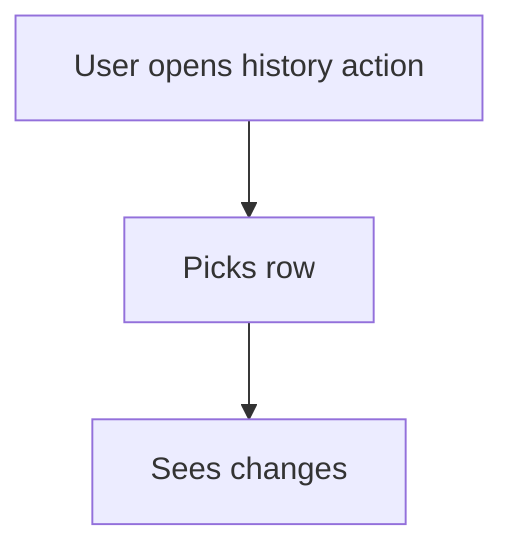

# Sheet history action

## Task

See who changed a row and when.

## How

- spreadsheetHistory action on the sheet for the roles that check.

## Workaround

No. Direct feature (spreadsheetHistory).

## Limits

- Shows changes per row; no report across rows.

## Flowchart

## Execute

Only use this to apply this into a Studio Enterprise via MCP.

Placeholders: Sheet, SheetHistory, Role. Needs first: Sheet.

1. Sheet: `set kind=spreadsheet ref=Sheet historys=[…]` (fields in the summary line; full before/after always kept), `auditTrailFormRoles=[Role]`.
2. Action: `add kind=action kind=spreadsheetHistory name=SheetHistory spreadsheet=Sheet`.
3. `set kind=group actionPermissionMap={"SheetHistory":{"roles":[Role]}}`.
4. `validate` till ok=true.

Gaps: whether `auditTrailFormRoles` is needed for the history action unconfirmed (verify: describe).
