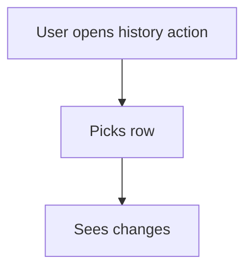

# Sheet history action

## Task

See who changed a row and when.

## How

- spreadsheetHistory action on the sheet for the roles that check.

## Workaround

No. Direct feature (spreadsheetHistory).

## Limits

- Shows changes per row; no report across rows.

## Flowchart

