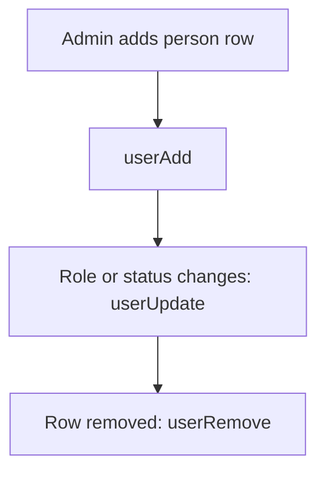

# Sheet row drives app user

## Task

Adding, changing or removing a person row (employee, customer) adds, updates or removes the app user.

## How

- Workflow on insert-after: userAdd, then write the user back to the row.
- Update-after: branch on roles, manager or status change; userUpdate; switch on status to activate or deactivate.
- Remove-before: userRemove.

## Workaround

No. Direct feature (user nodes in workflow).

## Limits

- Handle and contact must be valid before insert or userAdd fails.
- Role lists on the row must match enterprise roles.

## Flowchart

## Execute

Only use this to apply this into a Studio Enterprise via MCP.

Placeholders: PersonSheet, PersonForm, Name, Handle, Roles, Manager, Status, VarStatus, AppUser, UserWf. Needs first: enterprise roles.

1. Var: `add kind=var kind=setOfText name=VarStatus deploy=fixedOnDeploy value={"Active":{},"Inactive":{}}`.
2. Fields: `type=text Name`, `type=handle Handle` (or `mobileNumber`), `type=setOfRole Roles`, `type=pickUser Manager roleIdDataSource=[…]`, `type=pickText Status source=VarStatus`, `type=pickUser AppUser` (user written back) (verify: describe).
3. Workflow: `add kind=workflow name=UserWf` (4 maps `{}`).
4. Insert: `eventSsInsertAfter spreadsheet=PersonSheet` → `userAdd userNameField userHandleField userRoles userManager outputField=AppUser` → `rowUpdate rowIdPointer={spreadsheet:PersonSheet,row:<$Curr row>} option=Mapping`.
5. Update: `eventSsUpdateAfter` → `branchIfElse option=Condition condition={statement:{lhs:Roles,operator:hasChanged}}` (also Manager) → `userUpdate userIdField=AppUser userRoles userManager`.
6. Status: `branchSwitchCase field=Status` → VALUE keyActive / keyInactive → `userUpdate userActivateField=<B constant true|false>`.
7. Remove: `eventSsRemoveBefore spreadsheet=PersonSheet` → `userRemove userIdField=AppUser`.
8. `set kind=workflow edgeMap` (NEXT, TRUE/FALSE, VALUE `value`=key). `validate` till ok=true.

Gaps: AppUser field type for `outputField` / `userIdField` unconfirmed; `userActivateField` binder shape; edgeMap entry keys unverified.
