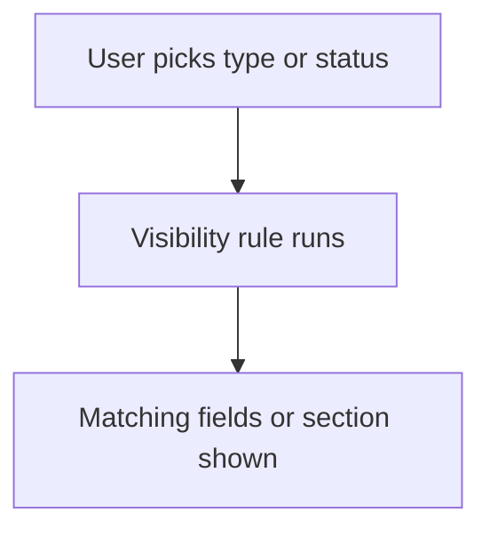

# Show or hide fields by value

## Task

Show only the fields or sections that fit the chosen type, source or status.

## How

- Visibility logic on the field or section, keyed on a pickText value or hasValue.
- onInitAndOnChange event.
- One section per type (visit type, lead source), shown by its rule.
- Yes or No item with quantity fields shown only on Yes.

## Workaround

No. Direct feature (visibility logic).

## Limits

- Hidden fields keep old values; clear them in a workflow if needed.
- Many rules on one form get hard to follow.

## Flowchart

## Execute

Only use this to apply this into a Studio Enterprise via MCP.

Placeholders: Form, VarType, Type, ASection, HideA, ShowA, ClearA, IsA. Needs first: Form.

1. Control: `add kind=var kind=setOfText name=VarType deploy=fixedOnDeploy value={…}` → `add kind=field type=pickText name=Type source=VarType`.
2. Targets: `add kind=composite type=section name=ASection` per type; Yes/No variant: `type=bool Has` + qty fields.
3. Actions: `add kind=formEventAction kind=hidden name=HideA comps=[ASection] actionOn=component`; `kind=visible name=ShowA`; optional `kind=clear name=ClearA comps=[…]`.
4. Condition: `add kind=formEventCondition name=IsA statement={lhs:Type,operator:equalTo,rhs:{argName:"rhs",kind:"constant",value:{type:"text",value:{value:"keyA"}}}}` (`hasValue`: omit rhs).
5. Event: `add kind=formEvent kind=onInitAndOnChange eventComps=[Type] actions=[{action:ShowA,condition:IsA},{action:HideA,condition:IsA,negate:true}]`.
6. `validate` till ok=true.

Gaps: rhs takes option key vs label unconfirmed; `actionOn` for a section (verify: describe).
