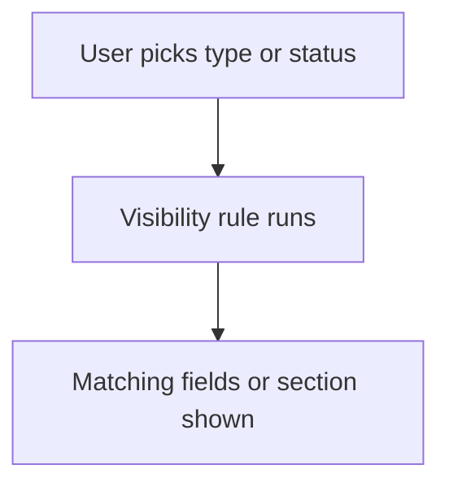

# Show or hide fields by value

## Task

Show only the fields or sections that fit the chosen type, source or status.

## How

- Visibility logic on the field or section, keyed on a pickText value or hasValue.
- onInitAndOnChange event.
- One section per type (visit type, lead source), shown by its rule.
- Yes or No item with quantity fields shown only on Yes.

## Workaround

No. Direct feature (visibility logic).

## Limits

- Hidden fields keep old values; clear them in a workflow if needed.
- Many rules on one form get hard to follow.

## Flowchart

