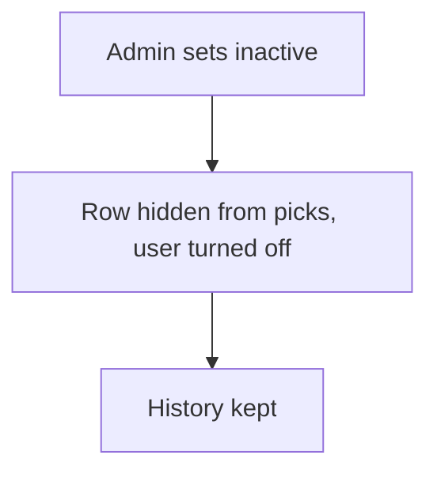

# Soft disable by status or flag

## Task

Stop using a customer, item or employee without deleting it; for an employee, turn the app user off but keep it.

## How

- Active or inactive pickText, or a disable bool, on the master row.
- Lists and refs filter on it.
- Employee row: workflow on update-after branches when Status changed, switches on Status and runs userUpdate to deactivate or activate the app user.

## Workaround

Yes for master rows: no archive; a status list or flag stands in. For app users the deactivate user node is direct.

## Limits

- Every ref and report must filter on the flag.
- A deactivated user keeps its rows; reassign open work by hand.

## Flowchart

## Execute

Only use this to apply this into a Studio Enterprise via MCP.

Placeholders: MasterSheet, VarActive, Status, ActiveCond, PersonSheet. Needs first: MasterSheet; for employees, apply PAT-sheet-row-drives-app-user Execute.

1. Flag: `add kind=var kind=setOfText name=VarActive deploy=fixedOnDeploy value={"Active":{},"Inactive":{}}` → `add kind=field type=pickText name=Status source=VarActive defaultOption=…` (verify: describe) (or `type=bool Disabled`).
2. `set kind=spreadsheet ref=MasterSheet queryables=[Status,…]`.
3. Filter: `add kind=var kind=condition name=ActiveCond` (Status equalTo keyActive) (verify: describe for `value.node`).
4. Use it: every `type=ref` field and `spreadsheetEditor` action / spreadsheet `report` → `filterCondition={cond:ActiveCond,negation:false}`.
5. Employee: workflow `eventSsUpdateAfter spreadsheet=PersonSheet` → `branchIfElse` Status `hasChanged` → `branchSwitchCase field=Status` → VALUE keyActive / keyInactive → `userUpdate userIdField userActivateField=<B true|false>`.
6. `set kind=workflow edgeMap`. `validate` till ok=true.

Gaps: `filterCondition.cond` as condition var name unconfirmed; `userActivateField` shape; edgeMap entry keys unverified.
