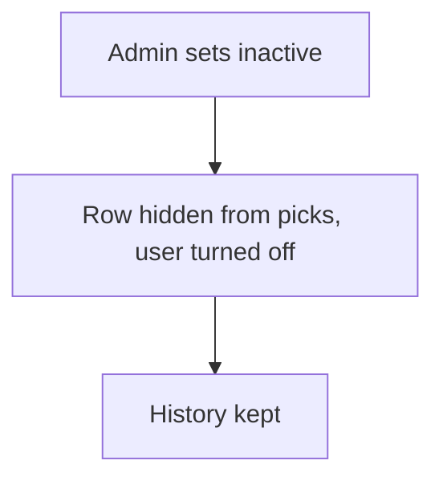

# Soft disable by status or flag

## Task

Stop using a customer, item or employee without deleting it; for an employee, turn the app user off but keep it.

## How

- Active or inactive pickText, or a disable bool, on the master row.
- Lists and refs filter on it.
- Employee row: workflow on update-after branches when Status changed, switches on Status and runs userUpdate to deactivate or activate the app user.

## Workaround

Yes for master rows: no archive; a status list or flag stands in. For app users the deactivate user node is direct.

## Limits

- Every ref and report must filter on the flag.
- A deactivated user keeps its rows; reassign open work by hand.

## Flowchart

