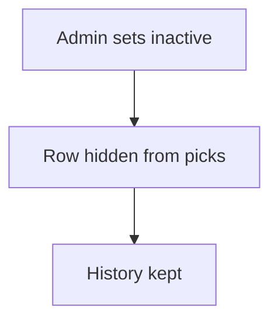

# Soft disable by status or flag

## Task

Stop using a customer, item or employee without deleting it.

## How

- Active or inactive pickText, or a disable bool, on the master row.
- Lists and refs filter on it.

## Workaround

Yes. No archive; a status list or flag stands in.

## Limits

- Every ref and report must filter on the flag.

## Flowchart

