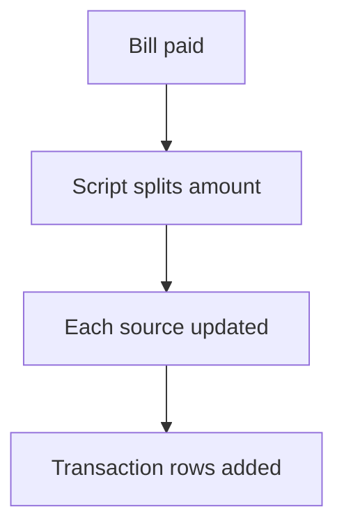

# Split a payment by script node

## Task

Take one bill from several sources (deposit, balance, cash) and log each part.

## How

- Yes or No fields for each source.
- executeJavascript works out each part.
- Log number updates and a transaction row per part.

## Workaround

Yes. No split-payment feature; a JavaScript node works out the parts.

## Limits

- Script logic is hidden from the flow view; keep it short.

## Flowchart

