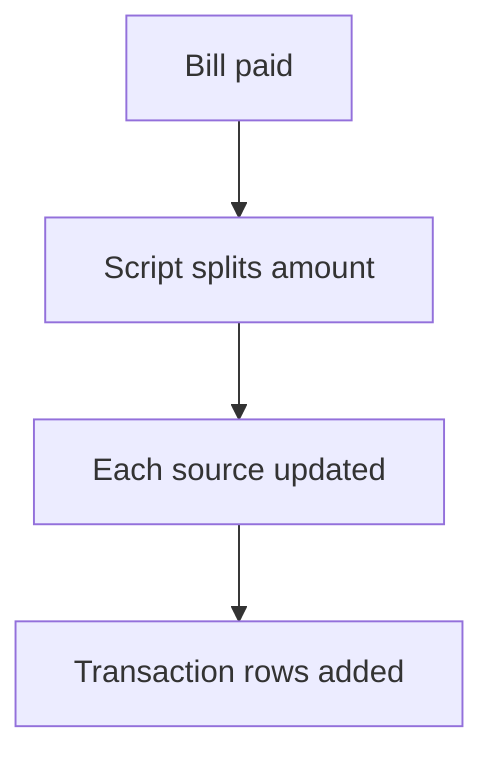

# Split a payment by script node

## Task

Take one bill from several sources (deposit, balance, cash) and log each part.

## How

- Yes or No fields for each source.
- executeJavascript works out each part.
- Log number updates and a transaction row per part.

## Workaround

Yes. No split-payment feature; a JavaScript node works out the parts.

## Limits

- Script logic is hidden from the flow view; keep it short.

## Flowchart

## Execute

Only use this to apply this into a Studio Enterprise via MCP.

Placeholders: BillSheet, BillForm, SplitOutForm, TxnSheet, TxnForm, Balance, SplitWf. Needs first: TxnSheet; master row with log field (apply PAT-running-total-by-log-field Execute).

1. Bill form: `type=bool UseDeposit`, `UseBalance`, `UseCash`; `type=decimal Amount`.
2. Script output: `add kind=form name=SplitOutForm` → section → `type=decimal DepositPart`, `BalancePart`, `CashPart`.
3. Workflow: `add kind=workflow name=SplitWf` (4 maps `{}`) → `eventSsInsertAfter spreadsheet=BillSheet` → `executeJavascript outputForm=SplitOutForm script={value:"…"} outputParamName=Split`.
4. Per part: `branchIfElse` part greaterThan 0 → `rowUpdateFieldLogNumber rowIdPointer=… outputLogNumberField=Balance operation=subtract inputField=<B parameter Split part>` → `paramCreate option=Mapping outputForm=TxnForm outputMapping=…` → `rowInsert spreadsheet=TxnSheet`.
5. `set kind=workflow edgeMap` (NEXT, TRUE/FALSE). `validate` till ok=true.

Gaps: how the script reads `$Curr` and fills `outputForm` unconfirmed (verify: describe); parameter binder shape; edgeMap entry keys unverified.
