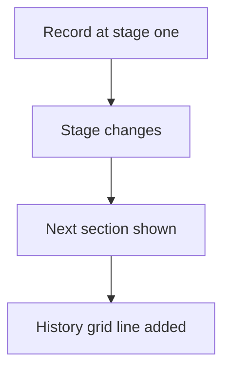

# Stage sections on one record

## Task

One record holds its whole journey: one section per stage plus a grid of past stages with dates.

## How

- Stage pickText on the sheet.
- One section per stage (qualification, demo, quote, implementation, converted) shown by visibility logic.
- Stage history grid with stage, start date, end date, status and notes.

## Workaround

No. Direct feature (sections, visibility, grid).

## Limits

- The history grid is filled by hand unless a workflow adds rows.
- A very wide record is slow to open on mobile.

## Flowchart

