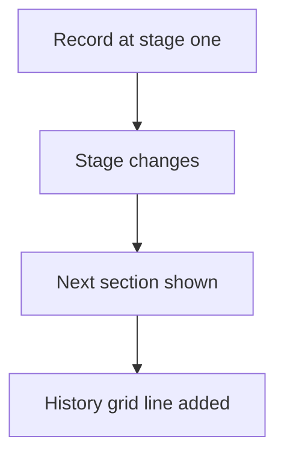

# Stage sections on one record

## Task

One record holds its whole journey: one section per stage plus a grid of past stages with dates.

## How

- Stage pickText on the sheet.
- One section per stage (qualification, demo, quote, implementation, converted) shown by visibility logic.
- Stage history grid with stage, start date, end date, status and notes.

## Workaround

No. Direct feature (sections, visibility, grid).

## Limits

- The history grid is filled by hand unless a workflow adds rows.
- A very wide record is slow to open on mobile.

## Flowchart

## Execute

Only use this to apply this into a Studio Enterprise via MCP.

Placeholders: RecordForm, VarStage, Stage, StageHistory, HistTable, RecordEditor. Needs first: RecordForm and its sheet.

1. Stage: `add kind=var kind=setOfText name=VarStage deploy=fixedOnDeploy value={"Qualification":{},"Demo":{},"Quote":{},…}` → `add kind=field type=pickText name=Stage source=VarStage`.
2. Sections: `add kind=composite type=section` per stage → its fields (`composite=<section>`).
3. History grid: `add kind=composite type=grid name=StageHistory` → `type=pickText HistStage source=VarStage`, `type=date StartDate`, `type=date EndDate`, `type=pickText HistStatus`, `type=paragraph Notes` → `add kind=gridLayout composite=StageHistory kind=table name=HistTable showComps=[…]`.
4. Visibility: apply PAT-show-field-by-value Execute, one rule per stage section.
5. Layout: `add kind=formLayout type=editor editorLayoutRenderingMode=tabs layoutCompositeMap={…,"StageHistory":{"gridLayout":"HistTable"}}`.
6. `validate` till ok=true.

Gaps: workflow filling history rows on stage change (grid mapping) unconfirmed; left manual.
