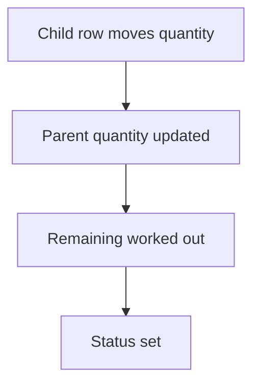

# Status from quantities

## Task

Order status (part dispatched, delivered, part received, received) follows the quantities still open.

## How

- Log number fields for dispatched or received quantity per line, updated by child rows.
- Remaining quantity formula.
- Branch or formula on remaining against ordered sets the status; flag on the parent for pending dispatch.

## Workaround

Yes. No delivery or receipt tracking step; remaining quantity and a status list stand in.

## Limits

- Status is only right if every child row updates the parent.

## Flowchart

