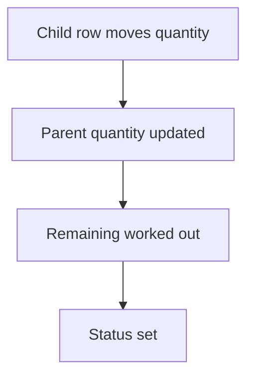

# Status from quantities

## Task

Order status (part dispatched, delivered, part received, received) follows the quantities still open.

## How

- Log number fields for dispatched or received quantity per line, updated by child rows.
- Remaining quantity formula.
- Branch or formula on remaining against ordered sets the status; flag on the parent for pending dispatch.

## Workaround

Yes. No delivery or receipt tracking step; remaining quantity and a status list stand in.

## Limits

- Status is only right if every child row updates the parent.

## Flowchart

## Execute

Only use this to apply this into a Studio Enterprise via MCP.

Placeholders: LineSheet, LineForm, Ordered, Dispatched, Remaining, VarOrderStatus, OrderStatus, PendingDispatch, DispatchSheet, QtyWf. Needs first: order + line sheets, DispatchSheet with ref to the line.

1. Line fields: `type=decimal Ordered`, `type=logDecimal Dispatched` (or `logNumber`), `type=decimal Remaining`.
2. Formula: `add kind=formFormula parent=LineForm assignToField=Remaining formula={value:"${f:Ordered} - ${f:Dispatched}"}`.
3. Status: `add kind=var kind=setOfText name=VarOrderStatus deploy=fixedOnDeploy value={…}` → `type=pickText OrderStatus source=VarOrderStatus`; `type=bool PendingDispatch` on parent.
4. Count: apply PAT-running-total-by-log-field Execute (`eventSsInsertAfter spreadsheet=DispatchSheet` → `rowUpdateFieldLogNumber outputLogNumberField=Dispatched operation=add`).
5. Set status: then `rowGet rowIdPointer=<line>` → `applyFormula` remaining → `branchIfElse` Remaining lessThanOrEqualTo 0 → TRUE `rowUpdate` OrderStatus=keyDelivered; FALSE `rowUpdate` keyPartDispatched + PendingDispatch.
6. `set kind=workflow edgeMap`. `validate` till ok=true.

Gaps: form formula re-run after a workflow log update unconfirmed (so recompute in workflow). edgeMap entry keys unverified.
