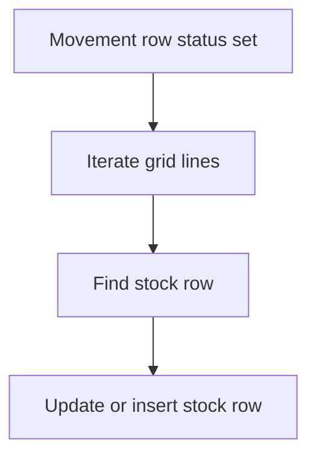

# Stock moves by workflow

## Task

Receiving, issuing, transferring, producing, dispatching or reserving goods changes stock per item and place.

## How

- Stock sheet per item (and warehouse) with log number quantity fields.
- Workflow on insert-after or on status change (Received, Transferred, Approved).
- Iterate the grid lines; query the stock row; update its log field, or insert a new stock row when none exists.
- Reserve on order approval, release on dispatch; reverse when approval is undone.
- Processed flag per line so a line is counted once.

## Workaround

No. Direct workflow and log fields; stock is kept by workflow, not computed.

## Limits

- No floor on log fields; a branch may reset negative stock.
- Edits after the status change do not move stock again unless built.
- No stock ledger view; reports read movement sheets.

## Flowchart

## Execute

Only use this to apply this into a Studio Enterprise via MCP.

Placeholders: StockSheet, StockForm, Item, Warehouse, Qty, Reserved, MoveSheet, Lines, Processed, StockWf. Needs first: item and warehouse sheets with list|card layouts.

1. Stock form: `type=ref Item`, `type=ref Warehouse`, `type=logDecimal Qty`, `type=logDecimal Reserved` → `add kind=spreadsheet name=StockSheet form=StockForm queryables=[Item,Warehouse] uniqueIndexs=[Item,Warehouse] uniquenessMode=combined`.
2. Move form: `type=pickText Status`; `kind=composite type=grid name=Lines` → `type=ref Item`, `type=decimal LineQty`, `type=bool Processed`.
3. Workflow: `add kind=workflow name=StockWf` (4 maps `{}`) → `eventSsInsertAfter` or `eventSsUpdateAfter spreadsheet=MoveSheet` → `branchIfElse` Status equalTo keyReceived.
4. Loop: `branchIterateGrid grid=Lines` → `branchIfElse` Processed → `ssSearchRows spreadsheet=StockSheet filterCondition=…` (or `ssExecuteQuery`) → `paramExist`.
5. TRUE: `rowUpdateFieldLogNumber outputLogNumberField=Qty operation=add|subtract inputField=<B $Iter LineQty>`. FALSE: `paramCreate option=Mapping outputForm=StockForm` → `rowInsert spreadsheet=StockSheet`.
6. Mark done: `fieldSet` Processed=true per line → after loop `rowUpdate` on `$Curr`.
7. Reserve / release: same loop on Reserved; reverse on undo (apply PAT-undo-on-cancel Execute).
8. `set kind=workflow edgeMap` (TRUE/FALSE, ITERATE body, NEXT back to iterate). `validate` till ok=true.

Gaps: `ssSearchRows` output param and `filterCondition` with `$Iter` values unconfirmed; writing Processed on grid rows (verify: describe). edgeMap entry keys unverified.
