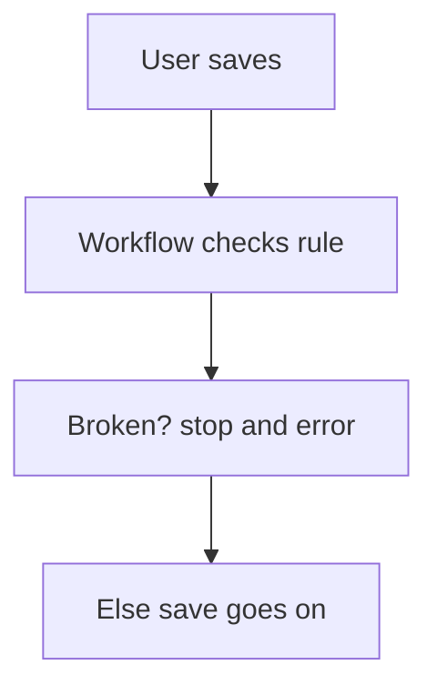

# Stop a save by workflow check

## Task

Refuse a save or remove that breaks a rule (stock short, order approved, missing refs).

## How

- Workflow on insert-before, update-before, or remove event.
- Branch on the rule (quantity against stock, approval status, empty refs).
- stopAndError with a message, or param update to mark the row.

## Workaround

Yes. No cross-field validation rule; a before or after event with stopAndError stands in.

## Limits

- After events roll back with an error; the user sees the message only after saving.
- Rules live in workflows, not on the form.

## Flowchart

## Execute

Only use this to apply this into a Studio Enterprise via MCP.

Placeholders: Sheet, CheckWf, StockSheet, Flag. Needs first: Sheet; rows the rule reads (stock, approval).

1. Workflow: `add kind=workflow name=CheckWf` (4 maps `{}`).
2. Event: `add kind=node kind=eventSsInsertBefore` (or `eventSsUpdateBefore` / `eventSsRemoveBefore`) `spreadsheet=Sheet`.
3. Fetch (if rule needs other rows): `rowGet rowIdPointer={spreadsheet:StockSheet,row:<B field $Curr>}` or `ssExecuteQuery`.
4. Rule: `branchIfElse option=Condition condition={statement:{lhs,operator:greaterThan,rhs}}` (or `validate condition=…`, fail → ERROR edge).
5. Stop: TRUE → `stopAndError message={value:"Only ${Stock} left",paramSet:["Stock"]}`. Mark variant: `paramUpdate option=Mapping pipelineParam=$Curr outputMapping=…` sets Flag.
6. `set kind=workflow edgeMap`: event → fetch NEXT; fetch → branch NEXT; branch → stop TRUE.
7. `validate` till ok=true.

Gaps: `condition` untyped; comparing a field across params (`$Curr` vs `$Prev`) shape unconfirmed (verify: describe). edgeMap entry keys unverified.
