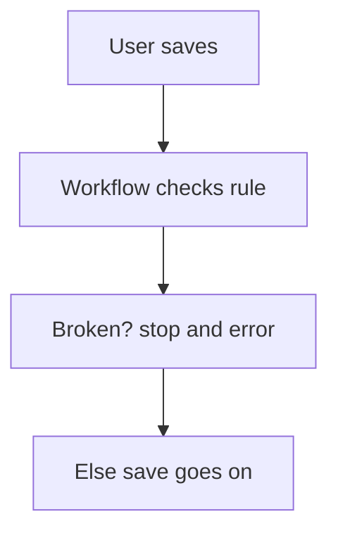

# Stop a save by workflow check

## Task

Refuse a save or remove that breaks a rule (stock short, order approved, missing refs).

## How

- Workflow on insert-before, update-before, or remove event.
- Branch on the rule (quantity against stock, approval status, empty refs).
- stopAndError with a message, or param update to mark the row.

## Workaround

Yes. No cross-field validation rule; a before or after event with stopAndError stands in.

## Limits

- After events roll back with an error; the user sees the message only after saving.
- Rules live in workflows, not on the form.

## Flowchart

