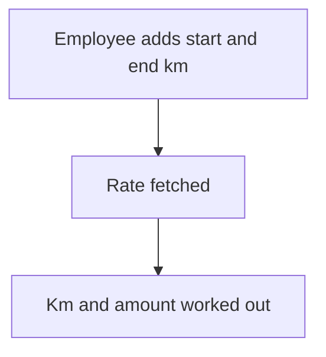

# Travel amount from km and rate

## Task

Work out a travel claim from start and end km (with meter photos) and a rate per vehicle type.

## How

- Start and end km numbers with camera photos.
- Rate per vehicle type kept on the employee row, fetched by a query or button.
- Formula for total km and amount.

## Workaround

No. Direct feature (formula and query).

## Limits

- Readings are typed; photos are the only proof.

## Flowchart

## Execute

Only use this to apply this into a Studio Enterprise via MCP.

Placeholders: ClaimForm, EmployeeSheet, EmployeeForm, VarVehicle, Rate, RateReport. Needs first: EmployeeSheet with a list|card layout.

1. Employee: `type=decimal` rate field per vehicle type (or one Rate).
2. Claim: `add kind=var kind=setOfText name=VarVehicle deploy=fixedOnDeploy value={…}` → `type=pickText VehicleType source=VarVehicle`, `type=decimal StartKm`, `EndKm`, `type=camera StartPhoto`, `EndPhoto`, `type=decimal Rate`, `TotalKm`, `Amount`.
3. Rate fetch: `type=ref Employee spreadsheet=EmployeeSheet layoutSpreadsheet=<list> copyFieldMap` (rate into Rate), or `type=button targetType=callReport report=RateReport reportOutputMapping=…` (verify: describe).
4. Formulas: `add kind=formFormula assignToField=TotalKm formula={value:"${f:EndKm} - ${f:StartKm}"}`; `assignToField=Amount formula={value:"${f:TotalKm} * ${f:Rate}"}`.
5. `validate` till ok=true.

Gaps: copyFieldMap shape; picking rate by vehicle type needs JS in formula or a report (verify: describe).
