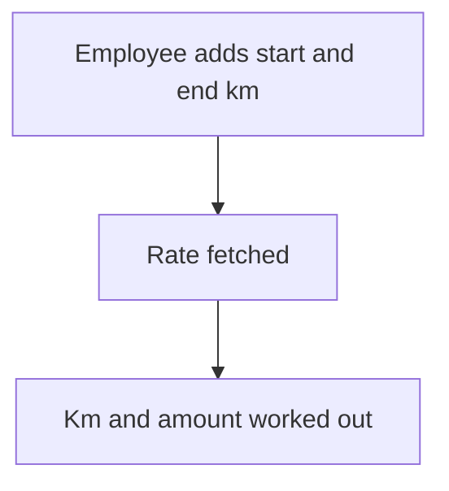

# Travel amount from km and rate

## Task

Work out a travel claim from start and end km (with meter photos) and a rate per vehicle type.

## How

- Start and end km numbers with camera photos.
- Rate per vehicle type kept on the employee row, fetched by a query or button.
- Formula for total km and amount.

## Workaround

No. Direct feature (formula and query).

## Limits

- Readings are typed; photos are the only proof.

## Flowchart

