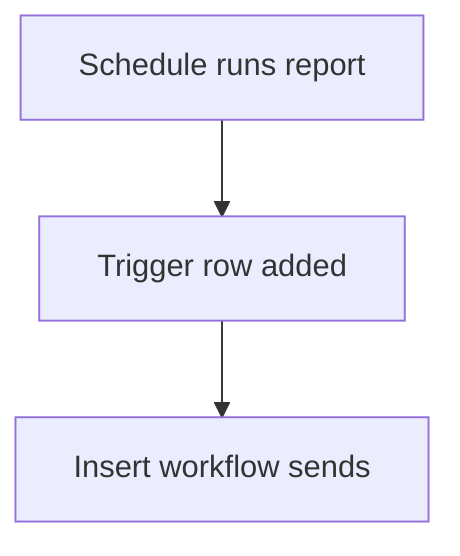

# Trigger row starts a workflow

## Task

Start a report send or message job by adding a row to a helper sheet.

## How

- Helper sheet with a flag and summary fields.
- Schedule or other workflow inserts or forwards a row.
- Workflow on that sheet's insert does the job.

## Workaround

Yes. No direct run-now or send-report step; a trigger row stands in.

## Limits

- Helper sheets fill up; clean them on a schedule.

## Flowchart

## Execute

Only use this to apply this into a Studio Enterprise via MCP.

Placeholders: TriggerForm, TriggerSheet, Send, JobWf. Needs first: the source workflow (schedule or event).

1. Helper: `add kind=form name=TriggerForm` → `kind=composite type=section` → `type=bool Send` + summary fields → `add kind=spreadsheet name=TriggerSheet form=TriggerForm`.
2. Source workflow: `paramCreate option=Mapping outputForm=TriggerForm outputMapping=…` → `rowInsert spreadsheet=TriggerSheet` (or `rowForward toGroups=[…]`).
3. Job: `add kind=workflow name=JobWf` (4 maps `{}`) → `eventSsInsertAfter spreadsheet=TriggerSheet` → `branchIfElse` Send equalTo true → `executeReport report=…` / `sendMessageToGroups` / `generatePdf`.
4. Clean up: scheduled `ssRemoveRows spreadsheet=TriggerSheet filterCondition=…` (apply PAT-scheduled-job-over-rows Execute).
5. `set kind=workflow edgeMap` per workflow (NEXT, TRUE). `validate` till ok=true.

Gaps: `outputMapping` / `filterCondition` untyped (verify: describe). edgeMap entry keys unverified.
