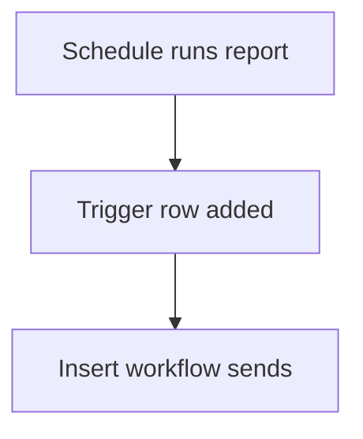

# Trigger row starts a workflow

## Task

Start a report send or message job by adding a row to a helper sheet.

## How

- Helper sheet with a flag and summary fields.
- Schedule or other workflow inserts or forwards a row.
- Workflow on that sheet's insert does the job.

## Workaround

Yes. No direct run-now or send-report step; a trigger row stands in.

## Limits

- Helper sheets fill up; clean them on a schedule.

## Flowchart

