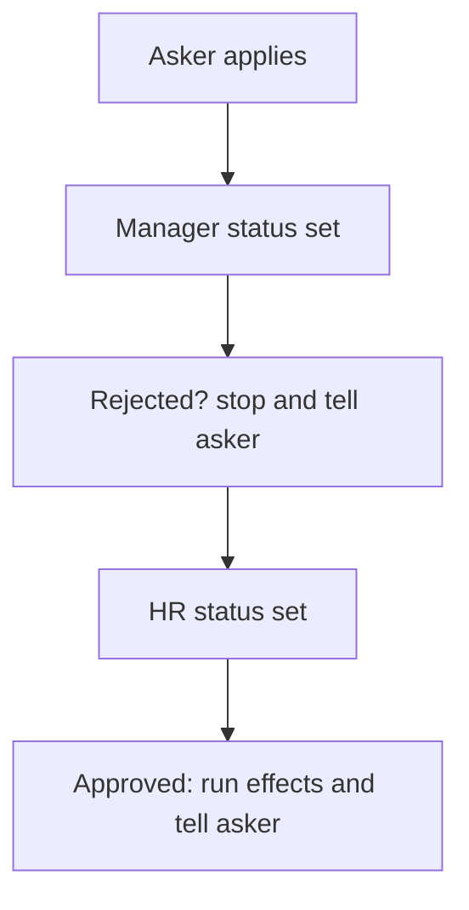

# Two-level approval by status

## Task

A manager approves first, then HR approves the same request.

## How

- Two status pickText fields on the sheet, one per approver level (manager status, HR status).
- Workflow on update-after: branch on the first status; a reject ends it.
- Nested branch on the second status; on Approved the effects run (balance update).
- Push message to the asker at each decision.

## Workaround

Yes. No multi-level approval step; two status lists and nested branches stand in.

## Limits

- Order of levels is not enforced by the sheet; rights and branches keep it.
- Each extra level needs one more status field and branch.

## Flowchart

