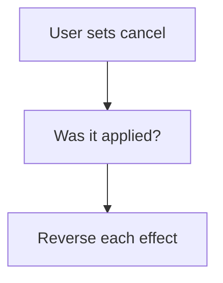

# Undo effects on cancel

## Task

Cancelling or removing a row puts back what it changed (balance, stock, attendance).

## How

- Cancel bool flag, or status moving away from Approved.
- Workflow branch on the change to cancelled.
- Reverse log number updates; remove the transaction row; fieldRemove on linked rows.
- Remove-before event variant for deleted rows.

## Workaround

Yes. No cancel step; a bool flag or status branch with reverse updates stands in.

## Limits

- Every effect needs its own reverse step; missing one leaves data wrong.

## Flowchart

## Execute

Only use this to apply this into a Studio Enterprise via MCP.

Placeholders: Sheet, Cancelled, MasterSheet, Balance, TxnSheet, LinkedSheet, UndoWf. Needs first: the forward workflow whose effects are undone.

1. Flag: `type=bool Cancelled` (or existing Status pickText).
2. Workflow: `add kind=workflow name=UndoWf` (4 maps `{}`) → `eventSsUpdateAfter spreadsheet=Sheet`.
3. Check: `branchIfElse option=Condition condition=…` Cancelled `hasChanged` and equalTo true (or Status was keyApproved on `$Prior`, now not).
4. Reverse each effect: `rowUpdateFieldLogNumber outputLogNumberField=Balance operation=<opposite of forward>`; `rowRemove rowIdPointer={spreadsheet:TxnSheet,row:…}`; `rowGet` linked row → `fieldRemove field=…` → `rowUpdate`.
5. Delete variant: `eventSsRemoveBefore spreadsheet=Sheet` → same reverse nodes.
6. `set kind=workflow edgeMap` (NEXT, TRUE). `validate` till ok=true.

Gaps: andOr condition shape and `$Prior` binder unconfirmed (verify: describe). edgeMap entry keys unverified.
