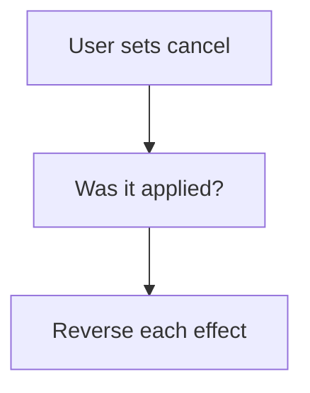

# Undo effects on cancel

## Task

Cancelling or removing a row puts back what it changed (balance, stock, attendance).

## How

- Cancel bool flag, or status moving away from Approved.
- Workflow branch on the change to cancelled.
- Reverse log number updates; remove the transaction row; fieldRemove on linked rows.
- Remove-before event variant for deleted rows.

## Workaround

Yes. No cancel step; a bool flag or status branch with reverse updates stands in.

## Limits

- Every effect needs its own reverse step; missing one leaves data wrong.

## Flowchart

