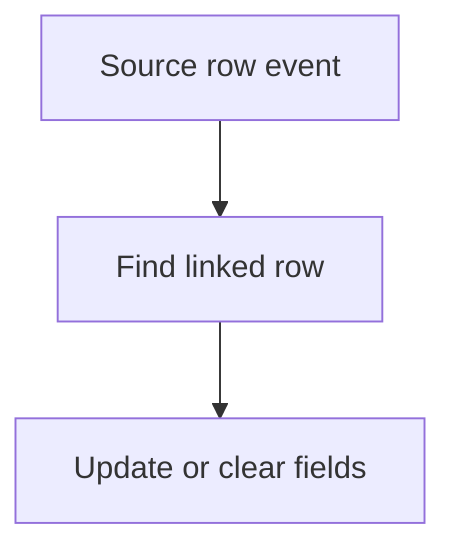

# Update linked rows from a workflow

## Task

An event on one row writes into linked rows (vehicle and customer on assign, attendance on leave, parent status from child, plan done on visit).

## How

- Workflow on insert-after or update-after.
- rowUpdate on the linked sheet using the copied rowId.
- Switch on a value (duration, status) to pick what to write.
- fieldRemove to clear links on unassign.
- Loop variant: iterate a sheet to copy a value to many related rows.

## Workaround

No. Direct feature (rowUpdate and fieldRemove nodes). The loop variant stands in for a live link.

## Limits

- Needs the rowId of the target on the source row.
- Loops over big sheets are slow.

## Flowchart

## Execute

Only use this to apply this into a Studio Enterprise via MCP.

Placeholders: SourceSheet, TargetSheet, Target, TargetRowId, Status, LinkWf. Needs first: TargetSheet with a list|card layout.

1. Link: `type=ref name=Target spreadsheet=TargetSheet layoutSpreadsheet=<list> copyFieldMap` copying rowId into TargetRowId (verify: describe).
2. Workflow: `add kind=workflow name=LinkWf` (4 maps `{}`) → `eventSsInsertAfter` or `eventSsUpdateAfter spreadsheet=SourceSheet`.
3. Write: `rowUpdate rowIdPointer={spreadsheet:TargetSheet,row:<B field $Curr TargetRowId>} option=Mapping outputMapping={fromForm,toForm,fieldMappingMap}`.
4. Switch: `branchSwitchCase field=Status` → VALUE per key → its own `rowUpdate`.
5. Unassign: `rowGet` target → `fieldRemove field={param:"$Prev",field:…}` → `rowUpdate`.
6. Loop variant: `branchIterateSpreadsheet spreadsheet=TargetSheet filterCondition=…` → `rowUpdate` on `$Iter` row.
7. `set kind=workflow edgeMap` (NEXT, VALUE `value`=key, ITERATE). `validate` till ok=true.

Gaps: copyFieldMap shape; `$Curr` / `$Iter` row binder shape (verify: `schema kind=argBinder`). edgeMap entry keys unverified.
