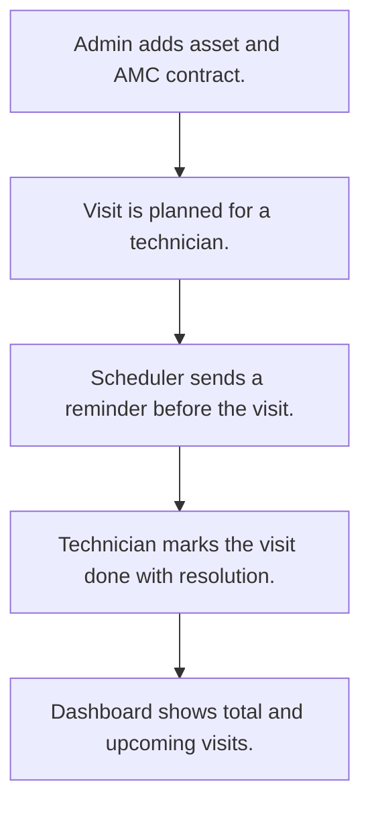

# AMC contracts and service visits

## Usual needs

- Usually has to keep assets with category, location, customer, purchase and install dates and visit frequency.
- Usually has to record an AMC contract per asset with start and end dates, SLA hours and price.
- Usually has to plan service visits under a contract for a technician.
- Usually has to remind the technician before a planned visit.
- Usually has to close a visit with resolution date and hours.
- Usually has to show total and upcoming visits for a date range.

## Process steps

1. Admin adds asset and AMC contract.
2. Visit is planned for a technician.
3. Scheduler sends a reminder before the visit.
4. Technician marks the visit done with resolution.
5. Dashboard shows total and upcoming visits.

## Usual sheets, key fields, roles

- Asset: Category, Location, Customer, PurchaseDate, InstallationDate, FrequencyOfVisit
- AMC: Asset ref, StartDate, EndDate, SLAHours, Price, Status
- AMCVisit: AMC ref, PlannedVisitDate, Technician (pickUser), Status, ResolutionHours
- Asset category, location and customer lists
- Roles: Admin, Service manager, Service technician.

## Neome App / Delivery hint

Neome App: amc-and-service-management. Delivery: standard (App gives it out of the box; only Neome App Build evidence so far, no client Build). Hint only; grilling decides.

## Flowchart

