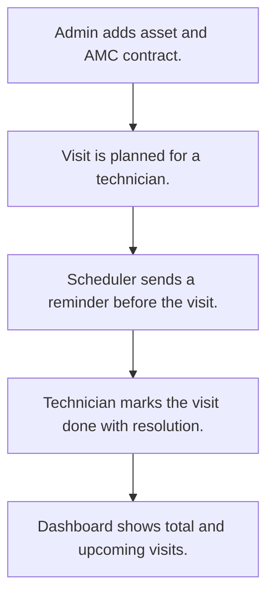

# AMC contracts and service visits

## Usual needs

- Usually has to keep assets with category, location, customer, purchase and install dates and visit frequency.
- Usually has to record an AMC contract per asset with start and end dates, SLA hours and price.
- Usually has to plan service visits under a contract for a technician.
- Usually has to remind the technician before a planned visit.
- Usually has to close a visit with resolution date and hours.
- Usually has to show total and upcoming visits for a date range.

## Process steps

1. Admin adds asset and AMC contract.
2. Visit is planned for a technician.
3. Scheduler sends a reminder before the visit.
4. Technician marks the visit done with resolution.
5. Dashboard shows total and upcoming visits.

## Usual sheets, key fields, roles

- Asset: Category, Location, Customer, PurchaseDate, InstallationDate, FrequencyOfVisit
- AMC: Asset ref, StartDate, EndDate, SLAHours, Price, Status
- AMCVisit: AMC ref, PlannedVisitDate, Technician (pickUser), Status, ResolutionHours
- Asset category, location and customer lists
- Roles: Admin, Service manager, Service technician.

## Neome App / Delivery hint

Neome App: amc-and-service-management. Delivery: standard (App gives it out of the box; only Neome App Build evidence so far, no Neome Build). Hint only; grilling decides.

## Flowchart

## Execute

Only use this to apply this into a Studio Enterprise via MCP.

Placeholders: AssetSheet, AmcSheet, AmcVisitSheet, VarAssetCategory, VarAmcStatus, VarVisitStatus. Needs first: if Neome App amc-and-service-management is installed, reuse its sheets; else none.

1. Roles + vars: `add kind=role` Admin, ServiceManager, ServiceTechnician; `add kind=var kind=setOfText deploy=fixedOnDeploy` for category, location, customer lists and AMC / visit status.
2. Asset: `add kind=form` → `kind=composite type=section` → Category, Location, Customer `type=pickText source=Var…`; PurchaseDate, InstallationDate `type=date`; FrequencyOfVisit `type=duration` (verify: describe) → `add kind=spreadsheet form=AssetForm` → `kind=spreadsheetLayout kind=table` + `kind=list`.
3. AMC: same order; Asset `type=ref spreadsheet=AssetSheet layoutSpreadsheet=<list>`, StartDate, EndDate `type=date`, SLAHours `type=number`, Price `type=decimal`, Status `type=pickText source=VarAmcStatus`. Asset details: apply PAT-copy-fields-from-ref Execute.
4. AMCVisit: Amc `type=ref spreadsheet=AmcSheet`, PlannedVisitDate `type=dateTime`, Technician `type=pickUser roleIdDataSource=[ServiceTechnician]`, Status `type=pickText`, ResolutionDate `type=date`, ResolutionHours `type=number`, SchedulerId `type=schedulerId`.
5. Logic: apply PAT-calculated-field, PAT-show-field-by-value Execute (resolution fields by Status).
6. Reminder: apply PAT-per-row-scheduler + PAT-scheduled-reminder-message Execute (`executeScheduler` per visit → `sendMessageToUsers` to Technician). Visit close: PAT-act-on-status-change.
7. Dashboard: apply PAT-query-report-with-filter + PAT-composite-report Execute (total, upcoming visits by date range); menu: PAT-menu-by-button-form. Technician as app user: PAT-sheet-row-drives-app-user.
8. Actions + group: `add kind=action kind=spreadsheetEditor` per sheet (table layout), `kind=rowInsert` for AMCVisit → `set kind=group actionPermissionMap` (Admin, ServiceManager all; ServiceTechnician visits).
9. `validate` till ok=true. `describe` sheets + workflows to confirm.

Gaps: FrequencyOfVisit type (duration vs pickText) not confirmed.
