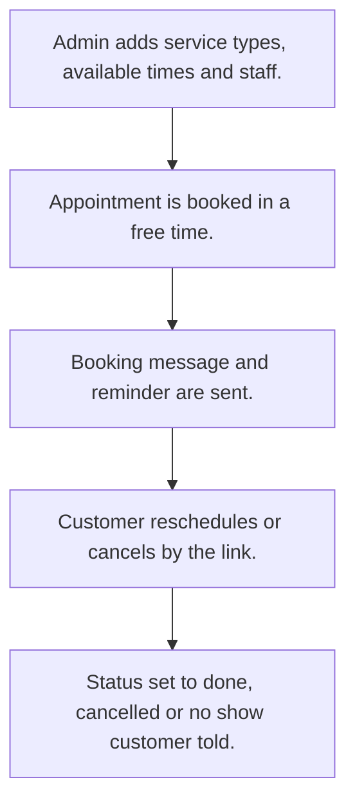

# Appointment booking

## Usual needs

- Usually has to keep service types with max duration.
- Usually has to keep weekly available times with no overlaps.
- Usually has to book an appointment for a service in a free time of a chosen date.
- Usually has to message the customer on booking, reminder, cancel, no show and done.
- Usually has to let the customer reschedule or cancel by a link, checked by OTP.
- Usually has to block changes to a completed or cancelled appointment.
- Usually has to show totals, per service, weekly and no-show counts.

## Process steps

1. Admin adds service types, available times and staff.
2. Appointment is booked in a free time.
3. Booking message and reminder are sent.
4. Customer reschedules or cancels by the link.
5. Status set to done, cancelled or no show; customer told.

## Usual sheets, key fields, roles

- ServiceType: ServiceType, MaxDuration, Color, IsActive
- Availability: Day, IsAvailable, FromTime and ToTime grid, Error
- Appointment: ServiceType ref, AppointmentDate, free time from a report, Name, MobileNumber, Status, RescheduleLink, SchedulerId
- RescheduleAppointment: Appointment ref, Action, NewDate, OTP
- Roles: Admin; customers book through the link.

## Neome App / Delivery hint

Neome App: appointment-booking. Delivery: standard (App gives it out of the box; only Neome App Build evidence so far, no Neome Build). Hint only; grilling decides.

## Flowchart

## Execute

Only use this to apply this into a Studio Enterprise via MCP.

Placeholders: ServiceTypeSheet, AvailabilitySheet, AppointmentSheet, RescheduleSheet, VarDay, VarAppointmentStatus, VarRescheduleAction. Needs first: if Neome App appointment-booking is installed, reuse it; else none.

1. Roles + vars: `add kind=role` Admin; `add kind=var kind=setOfText` VarDay, VarAppointmentStatus, VarRescheduleAction; `kind=var kind=duration` reminder lead time.
2. ServiceType: `add kind=form` → `kind=composite type=section` → ServiceType `type=text`, MaxDuration `type=duration`, Color `type=color`, IsActive `type=bool` → `add kind=spreadsheet` → `kind=spreadsheetLayout kind=table` + `kind=list`.
3. Availability: section → Day `type=pickText source=VarDay`, IsAvailable `type=bool`, Error `type=error` → `kind=composite type=grid` Slots → FromTime, ToTime `type=time` → sheet. No overlaps: apply PAT-error-field-check Execute.
4. Free-time report first: apply PAT-query-report-with-filter Execute (free times for a date + service).
5. Appointment: ServiceType `type=ref spreadsheet=ServiceTypeSheet layoutSpreadsheet=<list>`, AppointmentDate `type=date`, Slot `type=pickReportRow report=<FreeTimeReport>`, Name `type=text`, MobileNumber `type=mobileNumber`, Status `type=pickText`, RescheduleLink `type=hyperlink`, SchedulerId `type=schedulerId` → sheet. Id: PAT-generated-id.
6. Logic: PAT-calculated-field, PAT-copy-fields-from-ref, PAT-show-field-by-value, PAT-lock-fields-by-visibility (lock done / cancelled).
7. Reschedule: form with Appointment `type=ref`, Action `type=pickText`, NewDate `type=date`, OTP `type=text` → sheet; link: apply PAT-deeplink-to-form Execute (`add kind=deeplink kind=spreadsheetInsert visibilityConstraint=allowPublicSharing`). OTP check: PAT-stop-save-by-workflow-check; move booking: PAT-update-linked-rows.
8. Messages: PAT-message-on-event (booking), PAT-per-row-scheduler (reminder), PAT-act-on-status-change (cancel, no show, done); buttons: PAT-button-runs-workflow.
9. Reports: PAT-composite-report (totals, per service, weekly, no show). Staff users: PAT-sheet-row-drives-app-user.
10. Actions + group: `kind=spreadsheetEditor` per sheet, `kind=rowInsert` Appointment → `set kind=group actionPermissionMap` (Admin).
11. `validate` till ok=true. `describe` sheets, deeplink, workflows.

Gaps: pickReportRow needs report output grid + layout (verify: describe); OTP send and check shape not in guide.
