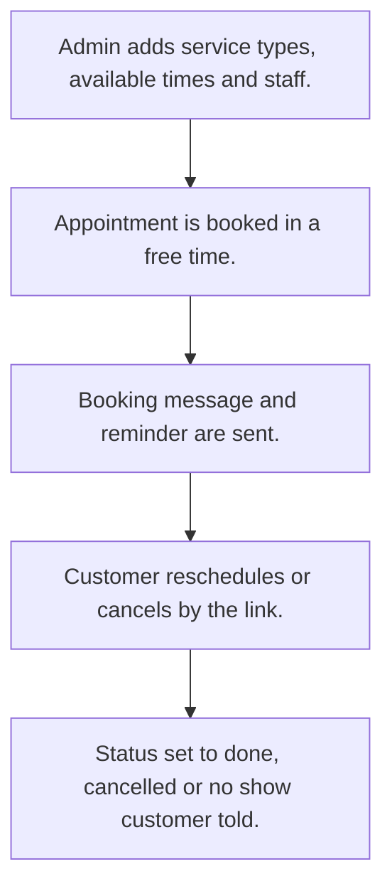

# Appointment booking

## Usual needs

- Usually has to keep service types with max duration.
- Usually has to keep weekly available times with no overlaps.
- Usually has to book an appointment for a service in a free time of a chosen date.
- Usually has to message the customer on booking, reminder, cancel, no show and done.
- Usually has to let the customer reschedule or cancel by a link, checked by OTP.
- Usually has to block changes to a completed or cancelled appointment.
- Usually has to show totals, per service, weekly and no-show counts.

## Process steps

1. Admin adds service types, available times and staff.
2. Appointment is booked in a free time.
3. Booking message and reminder are sent.
4. Customer reschedules or cancels by the link.
5. Status set to done, cancelled or no show; customer told.

## Usual sheets, key fields, roles

- ServiceType: ServiceType, MaxDuration, Color, IsActive
- Availability: Day, IsAvailable, FromTime and ToTime grid, Error
- Appointment: ServiceType ref, AppointmentDate, free time from a report, Name, MobileNumber, Status, RescheduleLink, SchedulerId
- RescheduleAppointment: Appointment ref, Action, NewDate, OTP
- Roles: Admin; customers book through the link.

## Neome App / Delivery hint

Neome App: appointment-booking. Delivery: standard (App gives it out of the box; only Neome App Build evidence so far, no client Build). Hint only; grilling decides.

## Flowchart

