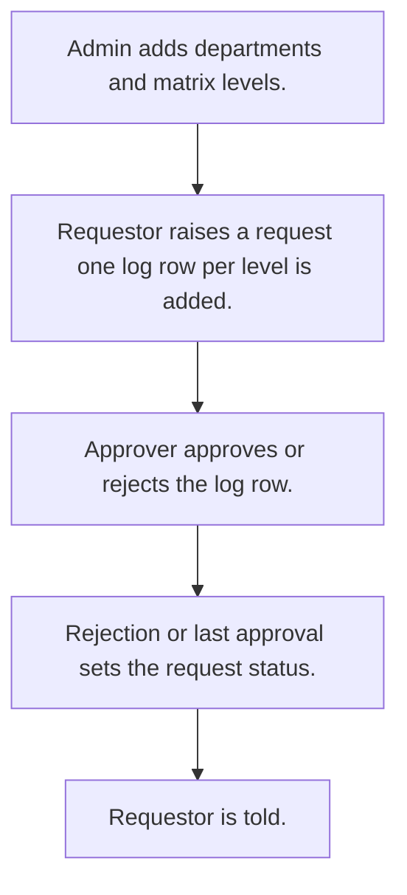

# Approval requests

## Usual needs

- Usually has to keep departments and an approval matrix of levels with an approver per level.
- Usually has to let a requestor raise a request with title, department, due date and files.
- Usually has to send the request to approvers level by level; a rejection ends it.
- Usually has to close the request when the last level approves.
- Usually has to tell the requestor on each status change and remind at due date.
- Usually has to show total, per department, per approver and overdue requests.

## Process steps

1. Admin adds departments and matrix levels.
2. Requestor raises a request; one log row per level is added.
3. Approver approves or rejects the log row.
4. Rejection or last approval sets the request status.
5. Requestor is told.

## Usual sheets, key fields, roles

- Department: Department
- ApprovalMatrix: Department ref, LevelSequence, Approver (pickUser)
- ApprovalRequest: ApprovalId, Department ref, Title, Status, DueDate, Approvers, Attachments
- ApprovalLog: ApprovalId, Level, Approver, Status, LastApprover, Disable
- Roles: Requestor, Approver, Admin.

## Neome App / Delivery hint

Neome App: approval-workflows. Delivery: standard (App gives it out of the box; only Neome App Build evidence so far, no client Build). Hint only; grilling decides.

## Flowchart

