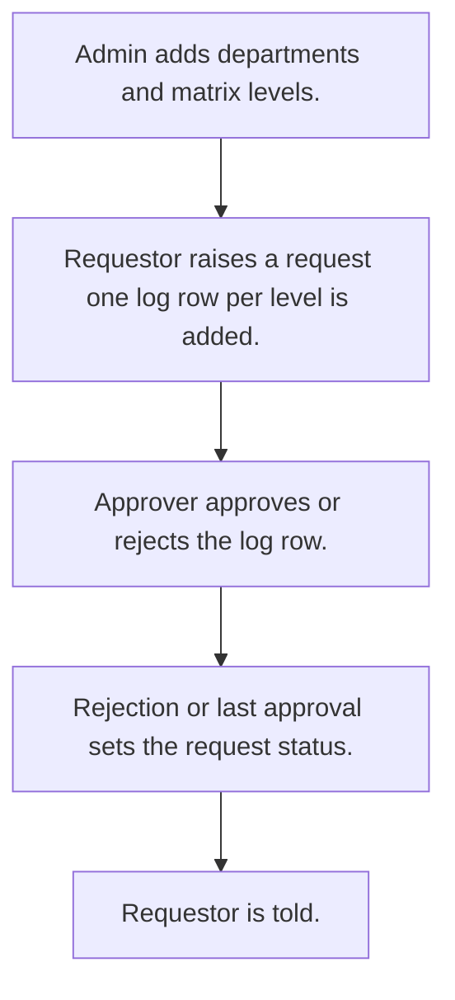

# Approval requests

## Usual needs

- Usually has to keep departments and an approval matrix of levels with an approver per level.
- Usually has to let a requestor raise a request with title, department, due date and files.
- Usually has to send the request to approvers level by level; a rejection ends it.
- Usually has to close the request when the last level approves.
- Usually has to tell the requestor on each status change and remind at due date.
- Usually has to show total, per department, per approver and overdue requests.

## Process steps

1. Admin adds departments and matrix levels.
2. Requestor raises a request; one log row per level is added.
3. Approver approves or rejects the log row.
4. Rejection or last approval sets the request status.
5. Requestor is told.

## Usual sheets, key fields, roles

- Department: Department
- ApprovalMatrix: Department ref, LevelSequence, Approver (pickUser)
- ApprovalRequest: ApprovalId, Department ref, Title, Status, DueDate, Approvers, Attachments
- ApprovalLog: ApprovalId, Level, Approver, Status, LastApprover, Disable
- Roles: Requestor, Approver, Admin.

## Neome App / Delivery hint

Neome App: approval-workflows. Delivery: standard (App gives it out of the box; only Neome App Build evidence so far, no Neome Build). Hint only; grilling decides.

## Flowchart

## Execute

Only use this to apply this into a Studio Enterprise via MCP.

Placeholders: DepartmentSheet, ApprovalMatrixSheet, ApprovalRequestSheet, ApprovalLogSheet, VarApprovalStatus. Needs first: if Neome App approval-workflows is installed, reuse it; else none.

1. Roles + vars: `add kind=role` Requestor, Approver, Admin; `add kind=var kind=setOfText` VarApprovalStatus; `kind=var kind=sequence` for ApprovalId.
2. Department: `add kind=form` → `kind=composite type=section` → Department `type=text` → `add kind=spreadsheet` → `kind=spreadsheetLayout kind=table` + `kind=list`.
3. ApprovalMatrix: Department `type=ref spreadsheet=DepartmentSheet layoutSpreadsheet=<list>`, LevelSequence `type=number`, Approver `type=pickUser roleIdDataSource=[Approver]` → sheet (`queryables=[Department, LevelSequence]`).
4. ApprovalRequest: ApprovalId `type=identifier` (PAT-generated-id), Department ref, Title `type=text`, Status `type=pickText source=VarApprovalStatus`, DueDate `type=date`, Approvers `type=setOfUser`, Attachments `type=setOfDocument` → sheet.
5. ApprovalLog: ApprovalId `type=text`, Level `type=number`, Approver `type=pickUser`, Status `type=pickText`, LastApprover `type=bool`, Disable `type=bool` → sheet (`updateRoles=[Approver]`).
6. Logic: PAT-calculated-field, PAT-show-field-by-value, PAT-lock-fields-by-visibility (Disable locks a log row).
7. Log rows: apply PAT-multi-level-approval Execute step 5 (`eventSsInsertAfter spreadsheet=ApprovalRequestSheet` → `ssExecuteQuery` ApprovalMatrixSheet by Department → `branchIterateGrid` → paramUpdate + `rowInsert spreadsheet=ApprovalLogSheet`).
8. Approve: apply PAT-multi-level-approval + PAT-approval-by-status Execute (log update → next level, or set request status on reject / last level); PAT-forward-row to approver; PAT-message-on-event to requestor; PAT-scheduled-reminder-message at DueDate.
9. Reports: PAT-query-report-with-filter + PAT-composite-report (total, per department, per approver, overdue). Approver users: PAT-sheet-row-drives-app-user.
10. Actions + group: `kind=rowInsert` ApprovalRequest, `kind=spreadsheetEditor` per sheet → `set kind=group actionPermissionMap` (Requestor, Approver, Admin).
11. `validate` till ok=true. `describe` sheets + workflows.

Gaps: matrix NeoQL by Department written by hand (verify: describe).
