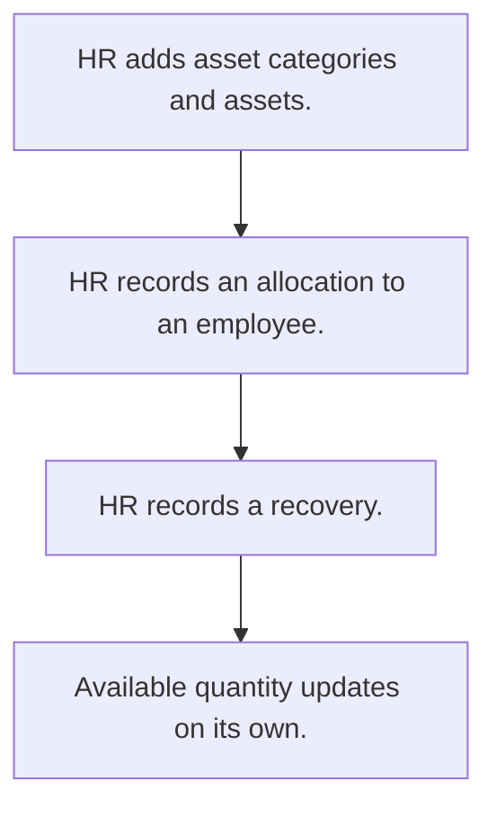

# Asset allocation

## Usual needs

- Usually has to keep a list of company assets with category, serial number, purchase date and quantity.
- Usually has to give assets to employees and take them back.
- Usually has to keep the available quantity right after each give or take back.

## Process steps

1. HR adds asset categories and assets.
2. HR records an allocation to an employee.
3. HR records a recovery.
4. Available quantity updates on its own.

## Usual sheets, key fields, roles

- Asset: AssetName or type, category, SerialNumber, PurchaseDate, Quantity (log number), holder
- Allocation and recovery: Date, Employee, grid of Asset and Quantity
- Roles: HR, Owner, Employee.

## Neome App / Delivery hint

Neome App: none in the catalog. Delivery: configuration. Hint only; grilling decides.

## Flowchart

