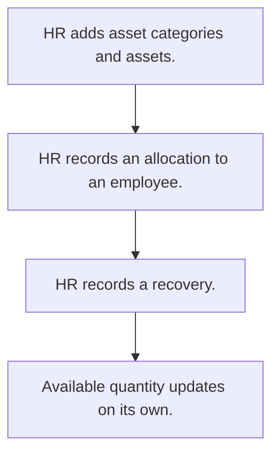

# Asset allocation

## Usual needs

- Usually has to keep a list of company assets with category, serial number, purchase date and quantity.
- Usually has to give assets to employees and take them back.
- Usually has to keep the available quantity right after each give or take back.

## Process steps

1. HR adds asset categories and assets.
2. HR records an allocation to an employee.
3. HR records a recovery.
4. Available quantity updates on its own.

## Usual sheets, key fields, roles

- Asset: AssetName or type, category, SerialNumber, PurchaseDate, Quantity (log number), holder
- Allocation and recovery: Date, Employee, grid of Asset and Quantity
- Roles: HR, Owner, Employee.

## Neome App / Delivery hint

Neome App: none in the catalog. Delivery: configuration. Hint only; grilling decides.

## Flowchart

## Execute

Only use this to apply this into a Studio Enterprise via MCP.

Placeholders: AssetCategorySheet, AssetSheet, AllocationSheet, VarMoveType. Needs first: none.

1. Roles + vars: `add kind=role` HR, Owner, Employee; `add kind=var kind=setOfText` VarMoveType (allocation, recovery). Category list: apply PAT-admin-kept-pick-list Execute.
2. Asset: `add kind=form` → `kind=composite type=section` → AssetName `type=text`, Category `type=ref spreadsheet=AssetCategorySheet`, SerialNumber `type=text`, PurchaseDate `type=date`, Quantity `type=logNumber`, Holder `type=pickUser roleIdDataSource=[Employee]` → `add kind=spreadsheet` → `kind=spreadsheetLayout kind=table` + `kind=list`.
3. Allocation: section → Date `type=date`, Employee `type=pickUser roleIdDataSource=[Employee]`, MoveType `type=pickText source=VarMoveType` → `kind=composite type=grid` Items → Asset `type=ref spreadsheet=AssetSheet layoutSpreadsheet=<list>`, Quantity `type=number` → sheet. Asset details: PAT-copy-fields-from-ref.
4. Quantity: apply PAT-stock-moves-by-workflow Execute (`eventSsInsertAfter spreadsheet=AllocationSheet` → `branchIterateGrid grid=Items` → `rowUpdateFieldLogNumber outputLogNumberField=Quantity operation=subtract|add` by MoveType).
5. Actions + group: `kind=spreadsheetEditor` Asset, `kind=rowInsert` Allocation → `set kind=group actionPermissionMap` (HR, Owner).
6. `validate` till ok=true. `describe` sheets + workflow.

Gaps: one sheet with MoveType vs two sheets: confirm with user; `rowIdPointer` from grid ref row (verify: describe).
