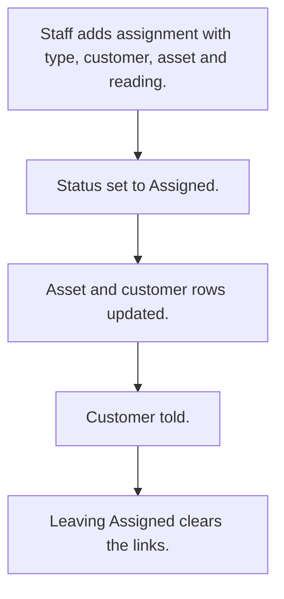

# Asset assignment to customer

## Usual needs

- Usually has to assign an asset to a customer, new or exchange.
- Usually has to copy customer and asset details from the master sheets.
- Usually has to record the previous asset on an exchange.
- Usually has to update the asset and customer rows on assign and clear them on unassign.
- Usually has to tell the customer when assigned.

## Process steps

1. Staff adds assignment with type, customer, asset and reading.
2. Status set to Assigned.
3. Asset and customer rows updated.
4. Customer told.
5. Leaving Assigned clears the links.

## Usual sheets, key fields, roles

- Assignment: Type {New|Exchange}, Customer, Asset, reading, Status {Pending|Assigned|Cancelled}
- Roles: Employee.

## Neome App / Delivery hint

Neome App: vehicle-and-driver-management. Delivery: configuration. Hint only; grilling decides.

## Flowchart

## Execute

Only use this to apply this into a Studio Enterprise via MCP.

Placeholders: AssignmentSheet, CustomerSheet, AssetSheet, VarAssignType, VarAssignStatus. Needs first: Customer sheet (TMOD-customer-master); Asset sheet (TMOD-asset-allocation), or if Neome App vehicle-and-driver-management is installed, reuse its asset sheet.

1. Roles + vars: `add kind=role` Employee; `add kind=var kind=setOfText` VarAssignType (New, Exchange), VarAssignStatus (Pending, Assigned, Cancelled).
2. Assignment: `add kind=form` → `kind=composite type=section` → Type `type=pickText source=VarAssignType`, Customer `type=ref spreadsheet=CustomerSheet layoutSpreadsheet=<list>`, Asset `type=ref spreadsheet=AssetSheet`, PreviousAsset `type=ref spreadsheet=AssetSheet`, Reading `type=decimal`, Status `type=pickText source=VarAssignStatus` → `add kind=spreadsheet` → `kind=spreadsheetLayout kind=table`.
3. Logic: apply PAT-copy-fields-from-ref (customer, asset details) + PAT-show-field-by-value Execute (PreviousAsset only on Exchange).
4. Workflow: apply PAT-act-on-status-change + PAT-update-linked-rows Execute (`eventSsUpdateAfter spreadsheet=AssignmentSheet` → `branchIfElse` Status Assigned → `rowUpdate` asset + customer rows; leaving Assigned → `rowUpdate` clear links). Tell customer: PAT-message-on-event.
5. Actions + group: `kind=rowInsert` + `kind=spreadsheetEditor` Assignment → `set kind=group actionPermissionMap` (Employee).
6. `validate` till ok=true. `describe` sheet + workflow.

Gaps: TMOD-asset-allocation AssetSheet has no Customer ref field; add one before step 4 (Open Item if unsure). "leaving Assigned" needs `$Prior` Status in `branchIfElse` condition (verify: describe).
