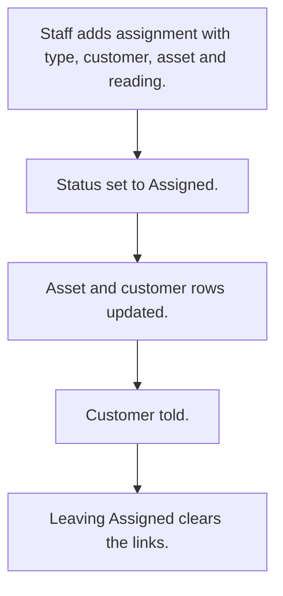

# Asset assignment to customer

## Usual needs

- Usually has to assign an asset to a customer, new or exchange.
- Usually has to copy customer and asset details from the master sheets.
- Usually has to record the previous asset on an exchange.
- Usually has to update the asset and customer rows on assign and clear them on unassign.
- Usually has to tell the customer when assigned.

## Process steps

1. Staff adds assignment with type, customer, asset and reading.
2. Status set to Assigned.
3. Asset and customer rows updated.
4. Customer told.
5. Leaving Assigned clears the links.

## Usual sheets, key fields, roles

- Assignment: Type {New|Exchange}, Customer, Asset, reading, Status {Pending|Assigned|Cancelled}
- Roles: Employee.

## Neome App / Delivery hint

Neome App: vehicle-and-driver-management. Delivery: configuration. Hint only; grilling decides.

## Flowchart

