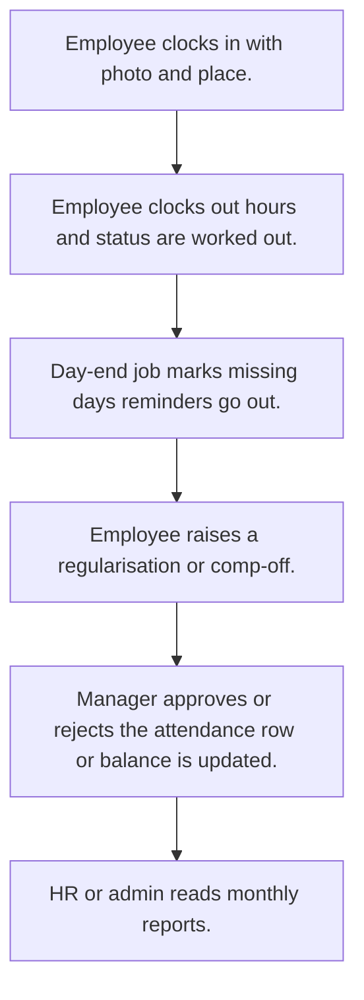

# Attendance

## Usual needs

- Usually has to let staff clock in and out with photo, time and place (and km for field staff).
- Usually has to work out hours, late or on time, and day status from clock times, leave and holidays.
- Usually has to let an employee ask to fix a day (regularisation or comp-off) and a manager approve it.
- Usually has to keep a holiday list kept by admin or HR.
- Usually has to remind people who have not clocked in or out.
- Usually has to close the day for missing rows on a schedule.
- Usually has to show monthly attendance per employee and for admin, by team or zone.
- Usually has to sometimes load worker punches from a device on a schedule.

## Process steps

1. Employee clocks in with photo and place.
2. Employee clocks out; hours and status are worked out.
3. Day-end job marks missing days; reminders go out.
4. Employee raises a regularisation or comp-off.
5. Manager approves or rejects; the attendance row or balance is updated.
6. HR or admin reads monthly reports.

## Usual sheets, key fields, roles

- Attendance: Date, ClockIn, ClockOut, photos, geo points, StartKm, EndKm, hours, Status {On Duty|Present|Half Day|On Leave|Absent}
- Holiday: Date, Name, type, state
- Regularisation or comp-off request: Date, times, reason, approval status
- Roles: Employee, Manager, HR, Admin.

## Neome App / Delivery hint

Neome App: attendance-and-leave. Delivery: configuration (clock fields, formulas, schedules). Device punch sync is custom work. Hint only; grilling decides.

## Flowchart

