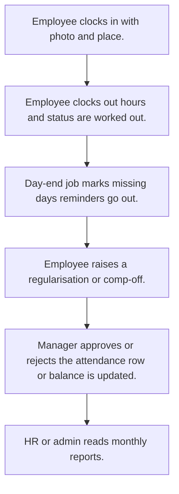

# Attendance

## Usual needs

- Usually has to let staff clock in and out with photo, time and place (and km for field staff).
- Usually has to work out hours, late or on time, and day status from clock times, leave and holidays.
- Usually has to let an employee ask to fix a day (regularisation or comp-off) and a manager approve it.
- Usually has to keep a holiday list kept by admin or HR.
- Usually has to remind people who have not clocked in or out.
- Usually has to close the day for missing rows on a schedule.
- Usually has to show monthly attendance per employee and for admin, by team or zone.
- Usually has to sometimes load worker punches from a device on a schedule.

## Process steps

1. Employee clocks in with photo and place.
2. Employee clocks out; hours and status are worked out.
3. Day-end job marks missing days; reminders go out.
4. Employee raises a regularisation or comp-off.
5. Manager approves or rejects; the attendance row or balance is updated.
6. HR or admin reads monthly reports.

## Usual sheets, key fields, roles

- Attendance: Date, ClockIn, ClockOut, photos, geo points, StartKm, EndKm, hours, Status {On Duty|Present|Half Day|On Leave|Absent}
- Holiday: Date, Name, type, state
- Regularisation or comp-off request: Date, times, reason, approval status
- Roles: Employee, Manager, HR, Admin.

## Neome App / Delivery hint

Neome App: attendance-and-leave. Delivery: configuration (clock fields, formulas, schedules). Device punch sync is custom work. Hint only; grilling decides.

## Flowchart

## Execute

Only use this to apply this into a Studio Enterprise via MCP.

Placeholders: AttendanceSheet, HolidaySheet, RegularisationSheet, VarAttendanceStatus, VarRequestKind, VarApprovalStatus. Needs first: if Neome App attendance-and-leave is installed, reuse it; else none.

1. Roles + vars: `add kind=role` Employee, Manager, HR, Admin; `add kind=var kind=setOfText` VarAttendanceStatus (On Duty, Present, Half Day, On Leave, Absent), VarRequestKind, VarApprovalStatus; `kind=var kind=time` shift start.
2. Attendance: `add kind=form` → `kind=composite type=section` → Date `type=date`, ClockIn, ClockOut `type=dateTime`, InPhoto, OutPhoto `type=camera`, InPoint, OutPoint `type=location`, StartKm, EndKm, Hours `type=decimal`, Status `type=pickText` → `add kind=spreadsheet` → `kind=spreadsheetLayout kind=table` + `kind=calendar`. Clock buttons: apply PAT-clock-in-out-with-photo Execute; defaults: PAT-default-value-on-form.
3. Hours, late, status: apply PAT-calculated-field Execute (`formFormula assignToField=Hours`, `assignToField=Status`).
4. Holiday: Date `type=date`, Name `type=text`, Type `type=pickText`, State `type=text` → sheet; kept by HR: PAT-admin-kept-pick-list.
5. Regularisation: Date `type=date`, FromTime, ToTime `type=time`, Kind `type=pickText source=VarRequestKind`, Reason `type=paragraph`, Status `type=pickText` → sheet. Approve + update attendance or balance: apply PAT-approval-by-status Execute.
6. Schedules: PAT-scheduled-job-over-rows (day-end marks missing days), PAT-scheduled-reminder-message (not clocked in / out). Field staff: PAT-device-location-trail.
7. Reports: PAT-composite-report (monthly per employee; admin by team or zone).
8. Device punch sync, only if asked: PAT-outside-service-by-plugin.
9. Actions + group: `kind=rowInsert` Attendance, Regularisation (Employee); `kind=spreadsheetEditor` + `kind=report` (Manager, HR, Admin) → `set kind=group actionPermissionMap`.
10. `validate` till ok=true. `describe` sheets + workflows.

Gaps: one row per employee per day via `partitionMap` (verify: describe); device punch plugin is import only (custom work).
