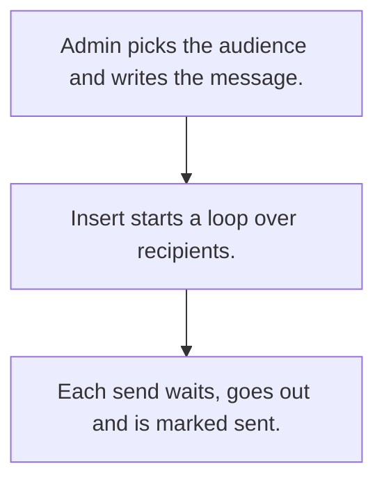

# Bulk marketing messages

## Usual needs

- Usually has to send an image, WhatsApp message or email to a list of customers or leads.
- Usually has to pick the audience by customer type or lead list.
- Usually has to space sends out with a random wait.
- Usually has to mark each row sent.
- Usually has to keep a list of contacts to message and documents to attach.

## Process steps

1. Admin picks the audience and writes the message.
2. Insert starts a loop over recipients.
3. Each send waits, goes out and is marked sent.

## Usual sheets, key fields, roles

- Send: Date, message or subject and body, image or documents, recipients grid (contact, Delay, Sent {Yes|No}, SentOn)
- Contacts to message: name, number, email, type
- Roles: Admin, Marketing.

## Neome App / Delivery hint

Neome App: none in the catalog. Delivery: configuration. Hint only; grilling decides.

## Flowchart

## Execute

Only use this to apply this into a Studio Enterprise via MCP.

Placeholders: SendSheet, ContactSheet, VarContactType, VarSent. Needs first: CustomerSheet (TMOD-customer-master) or LeadSheet (TMOD-lead-management), if the audience comes from them.

1. Roles + vars: `add kind=role` Admin, Marketing; `add kind=var kind=setOfText` VarContactType, VarSent (Yes, No).
2. Contacts: `add kind=form` → `kind=composite type=section` → Name `type=text`, Number `type=mobileNumber`, Email `type=email`, Type `type=pickText source=VarContactType` → `add kind=spreadsheet` (`queryables=[Type]`) → `kind=spreadsheetLayout kind=table` + `kind=list`.
3. Send: section → Date `type=date`, Audience `type=pickText source=VarContactType`, Subject `type=text`, Message `type=paragraph`, Image `type=image`, Documents `type=setOfDocument` → `kind=composite type=grid` Recipients → Contact `type=ref spreadsheet=ContactSheet layoutSpreadsheet=<list>`, Delay `type=number`, Sent `type=pickText source=VarSent`, SentOn `type=dateTime` → sheet.
4. Send loop: apply PAT-bulk-message-loop Execute (`eventSsInsertAfter spreadsheet=SendSheet` → `branchIterateGrid grid=Recipients` ITERATE → `wait` → `sendWhatsappMessage` or `sendEmail` → `rowUpdate` Sent; NEXT back to iterate).
5. Read contacts from an upload, only if asked: PAT-ai-reads-into-form.
6. Actions + group: `kind=rowInsert` Send, `kind=spreadsheetEditor` Contacts → `set kind=group actionPermissionMap` (Admin, Marketing).
7. `validate` till ok=true. `describe` sheets + workflow.

Gaps: filling Recipients from Audience (report or mapping) and random `wait.duration` binder (verify: describe).
