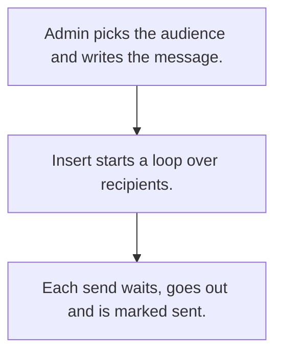

# Bulk marketing messages

## Usual needs

- Usually has to send an image, WhatsApp message or email to a list of customers or leads.
- Usually has to pick the audience by customer type or lead list.
- Usually has to space sends out with a random wait.
- Usually has to mark each row sent.
- Usually has to keep a list of contacts to message and documents to attach.

## Process steps

1. Admin picks the audience and writes the message.
2. Insert starts a loop over recipients.
3. Each send waits, goes out and is marked sent.

## Usual sheets, key fields, roles

- Send: Date, message or subject and body, image or documents, recipients grid (contact, Delay, Sent {Yes|No}, SentOn)
- Contacts to message: name, number, email, type
- Roles: Admin, Marketing.

## Neome App / Delivery hint

Neome App: none in the catalog. Delivery: configuration. Hint only; grilling decides.

## Flowchart

