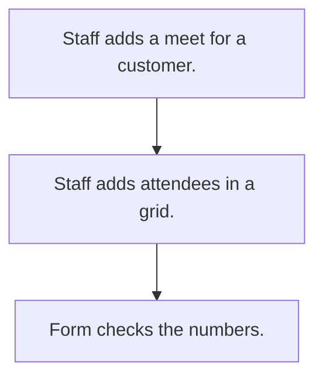

# Contact meet log

## Usual needs

- Usually has to let staff log a meeting with outside trade contacts linked to a customer.
- Usually has to keep photos, documents and a list of attendees with numbers.
- Usually has to block repeated or bad contact numbers.

## Process steps

1. Staff adds a meet for a customer.
2. Staff adds attendees in a grid.
3. Form checks the numbers.

## Usual sheets, key fields, roles

- Meet: Date, Customer ref, photos, documents, attendee grid (Name, ContactNumber)
- Roles: Staff, Manager, Admin, outside contact role.

## Neome App / Delivery hint

Neome App: none. Delivery: configuration. Hint only; grilling decides.

## Flowchart

## Execute

Only use this to apply this into a Studio Enterprise via MCP.

Placeholders: MeetSheet, CustomerSheet, ContactRole. Needs first: CustomerSheet (TMOD-customer-master).

1. Roles: `add kind=role` Staff, Manager, Admin, ContactRole.
2. Meet: `add kind=form` → `kind=composite type=section` → Date `type=date`, Customer `type=ref spreadsheet=CustomerSheet layoutSpreadsheet=<list>`, Photos `type=image`, Documents `type=setOfDocument`, NumberError `type=error` → `kind=composite type=grid` Attendees → Name `type=text`, ContactNumber `type=mobileNumber` → `add kind=spreadsheet` → `kind=spreadsheetLayout kind=table`.
3. Logic: apply PAT-copy-fields-from-ref (customer details), PAT-photo-and-document-capture, PAT-error-field-check Execute (repeat or bad numbers block send).
4. Views: apply PAT-role-views-of-one-sheet Execute (Staff own rows; Manager, Admin all).
5. Actions + group: `kind=rowInsert` + `kind=spreadsheetEditor` Meet → `set kind=group actionPermissionMap`.
6. `validate` till ok=true. `describe` sheet.

Gaps: repeat check across grid rows needs formula JS (verify: describe).
