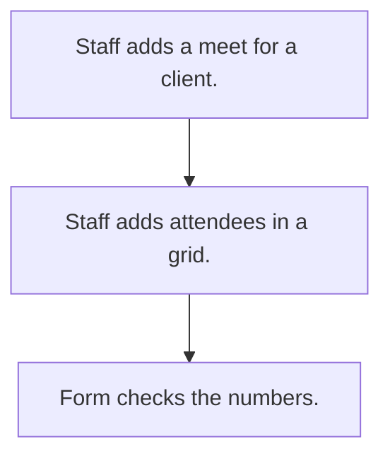

# Contact meet log

## Usual needs

- Usually has to let staff log a meeting with outside trade contacts linked to a client.
- Usually has to keep photos, documents and a list of attendees with numbers.
- Usually has to block repeated or bad contact numbers.

## Process steps

1. Staff adds a meet for a client.
2. Staff adds attendees in a grid.
3. Form checks the numbers.

## Usual sheets, key fields, roles

- Meet: Date, Client ref, photos, documents, attendee grid (Name, ContactNumber)
- Roles: Staff, Manager, Admin, outside contact role.

## Neome App / Delivery hint

Neome App: none. Delivery: configuration. Hint only; grilling decides.

## Flowchart

