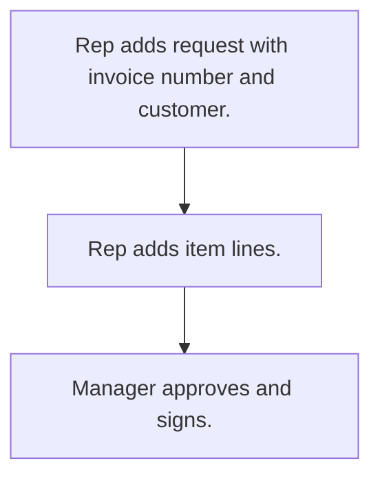

# Credit note request

## Usual needs

- Usually has to let a rep request a credit note against an invoice for a customer.
- Usually has to list items with reason, quantity, rate and amount.
- Usually has to let a manager approve and sign.

## Process steps

1. Rep adds request with invoice number and customer.
2. Rep adds item lines.
3. Manager approves and signs.

## Usual sheets, key fields, roles

- Credit note request: Date, ReferenceInvoiceNo, Customer, billing entity, item grid, approver fields, Signature
- Roles: Sales rep, Manager, Admin.

## Neome App / Delivery hint

Neome App: approval-workflows. Delivery: configuration. Hint only; grilling decides.

## Flowchart

