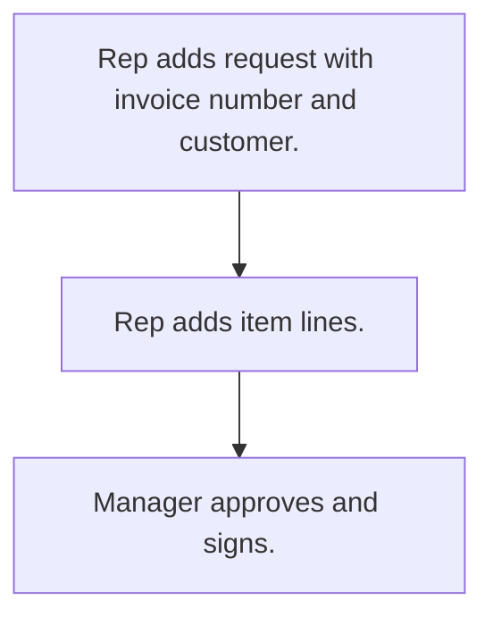

# Credit note request

## Usual needs

- Usually has to let a rep request a credit note against an invoice for a customer.
- Usually has to list items with reason, quantity, rate and amount.
- Usually has to let a manager approve and sign.

## Process steps

1. Rep adds request with invoice number and customer.
2. Rep adds item lines.
3. Manager approves and signs.

## Usual sheets, key fields, roles

- Credit note request: Date, ReferenceInvoiceNo, Customer, billing entity, item grid, approver fields, Signature
- Roles: Sales rep, Manager, Admin.

## Neome App / Delivery hint

Neome App: approval-workflows. Delivery: configuration. Hint only; grilling decides.

## Flowchart

## Execute

Only use this to apply this into a Studio Enterprise via MCP.

Placeholders: CreditNoteSheet, CustomerSheet, ItemSheet, VarReason, VarApprovalStatus. Needs first: CustomerSheet (TMOD-customer-master), ItemSheet (TMOD-inventory); Neome App approval-workflows only if multi-level approval is wanted.

1. Roles + vars: `add kind=role` SalesRep, Manager, Admin; `add kind=var kind=setOfText` VarReason, VarApprovalStatus.
2. Form: `add kind=form` → `kind=composite type=section` Request → Date `type=date`, ReferenceInvoiceNo `type=text`, Customer `type=ref spreadsheet=CustomerSheet layoutSpreadsheet=<list>`, BillingEntity `type=pickText`.
3. Items: `kind=composite type=grid` Items → Item `type=ref spreadsheet=ItemSheet`, Reason `type=pickText source=VarReason`, Quantity `type=number`, Rate, Amount `type=decimal`. Totals: apply PAT-line-items-grid-with-totals Execute.
4. Approval: `kind=composite type=section` Approval → Status `type=pickText source=VarApprovalStatus`, Approver `type=pickUser roleIdDataSource=[Manager]`, Signature `type=signature`; Manager-only via `permissionMatrix` (verify: describe).
5. Sheet: `add kind=spreadsheet form=CreditNoteForm` → `kind=spreadsheetLayout kind=table`. Logic: PAT-copy-fields-from-ref, PAT-photo-and-document-capture.
6. Actions + group: `kind=rowInsert` (SalesRep), `kind=spreadsheetEditor` (Manager, Admin) → `set kind=group actionPermissionMap`.
7. `validate` till ok=true. `describe` form + sheet.

Gaps: `permissionMatrix` shape not given in guide.
