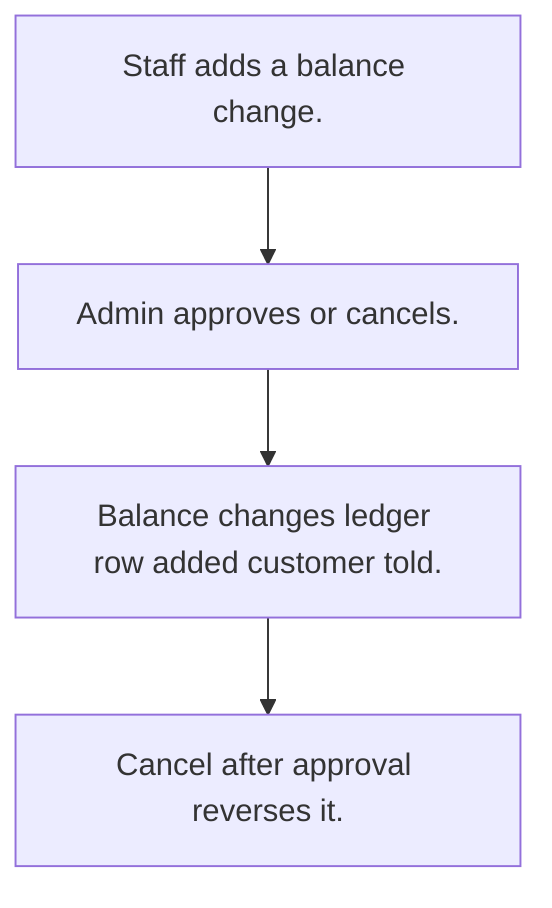

# Customer account ledger

## Usual needs

- Usually has to keep every balance change as a credit or debit row.
- Usually has to let staff ask to add or remove balance with a reason, and admin approve.
- Usually has to update the balance and add a ledger row on approval.
- Usually has to undo an approved change when it is cancelled.
- Usually has to tell the customer on a credit.
- Usually has to show totals for a date range.

## Process steps

1. Staff adds a balance change.
2. Admin approves or cancels.
3. Balance changes; ledger row added; customer told.
4. Cancel after approval reverses it.

## Usual sheets, key fields, roles

- Balance change: Date, Customer, Type {Credit|Debit}, Amount, Status {Pending|Approved|Cancelled}, Remarks
- Transaction: Customer, Date, BalanceBefore, Type, Mode, Amount
- Roles: Employee, Admin.

## Neome App / Delivery hint

Neome App: none in the catalog. Delivery: configuration. Hint only; grilling decides.

## Flowchart

## Execute

Only use this to apply this into a Studio Enterprise via MCP.

Placeholders: BalanceChangeSheet, TransactionSheet, CustomerSheet (Balance `type=logDecimal`), VarTxnType, VarChangeStatus. Needs first: Customer sheet with a log Balance field (TMOD-customer-master).

1. Roles + vars: `add kind=role` Employee, Admin; `add kind=var kind=setOfText` VarTxnType (Credit, Debit), VarChangeStatus (Pending, Approved, Cancelled).
2. BalanceChange: `add kind=form` → `kind=composite type=section` → Date `type=date`, Customer `type=ref spreadsheet=CustomerSheet layoutSpreadsheet=<list>`, Type `type=pickText source=VarTxnType`, Amount `type=decimal`, Status `type=pickText source=VarChangeStatus`, Remarks `type=paragraph` → `add kind=spreadsheet` (`updateRoles=[Admin]`) → `kind=spreadsheetLayout kind=table`.
3. Transaction: Customer ref, Date `type=dateTime`, BalanceBefore `type=decimal`, Type `type=pickText`, Mode `type=text`, Amount `type=decimal` → sheet (rows by workflow only) → table layout.
4. Approve: apply PAT-approval-by-status + PAT-running-total-by-log-field Execute (`eventSsUpdateAfter spreadsheet=BalanceChangeSheet` → `branchIfElse` Approved → `rowUpdateFieldLogNumber operation=add|subtract` → `rowInsert spreadsheet=TransactionSheet`).
5. Cancel after approval: apply PAT-undo-on-cancel Execute. Credit message: PAT-message-on-event. Customer details: PAT-copy-fields-from-ref.
6. Report: apply PAT-query-report-with-filter Execute (totals for a date range).
7. Actions + group: `kind=rowInsert` BalanceChange (Employee), `kind=spreadsheetEditor` both sheets + `kind=report` (Admin) → `set kind=group actionPermissionMap`.
8. `validate` till ok=true. `describe` sheets + workflows.

Gaps: undo needs `$Prior` Status in condition (verify: describe).
