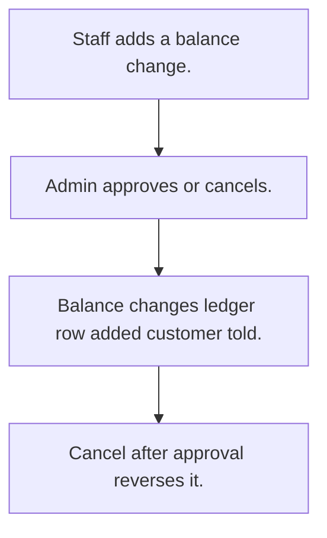

# Customer account ledger

## Usual needs

- Usually has to keep every balance change as a credit or debit row.
- Usually has to let staff ask to add or remove balance with a reason, and admin approve.
- Usually has to update the balance and add a ledger row on approval.
- Usually has to undo an approved change when it is cancelled.
- Usually has to tell the customer on a credit.
- Usually has to show totals for a date range.

## Process steps

1. Staff adds a balance change.
2. Admin approves or cancels.
3. Balance changes; ledger row added; customer told.
4. Cancel after approval reverses it.

## Usual sheets, key fields, roles

- Balance change: Date, Customer, Type {Credit|Debit}, Amount, Status {Pending|Approved|Cancelled}, Remarks
- Transaction: Customer, Date, BalanceBefore, Type, Mode, Amount
- Roles: Employee, Admin.

## Neome App / Delivery hint

Neome App: none in the catalog. Delivery: configuration. Hint only; grilling decides.

## Flowchart

