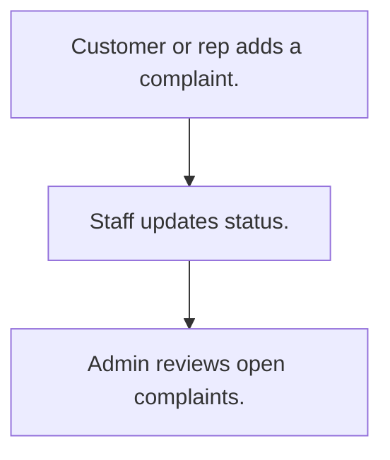

# Customer complaints

## Usual needs

- Usually has to let a customer or staff log a complaint for a customer with type, place, text and photos.
- Usually has to keep a complaint type list.
- Usually has to move the complaint through a status list.
- Usually has to list open complaints.

## Process steps

1. Customer or rep adds a complaint.
2. Staff updates status.
3. Admin reviews open complaints.

## Usual sheets, key fields, roles

- Complaint: Date, Customer ref, Type, Location, Description, photos, Status {Open|In Service|Resolved|Closed|Cancelled}
- ComplaintType: ComplaintType
- Roles: Customer, Employee or rep, Admin.

## Neome App / Delivery hint

Neome App: ticketing-and-task-management. Delivery: configuration. Hint only; grilling decides.

## Flowchart

## Execute

Only use this to apply this into a Studio Enterprise via MCP.

Placeholders: ComplaintSheet, ComplaintTypeSheet, CustomerSheet, VarComplaintStatus. Needs first: Customer sheet (TMOD-customer-master); if Neome App ticketing-and-task-management is installed, reuse it.

1. Roles + vars: `add kind=role` Customer, Employee, Admin; `add kind=var kind=setOfText` VarComplaintStatus (Open, In Service, Resolved, Closed, Cancelled).
2. Types: apply PAT-admin-kept-pick-list Execute (ComplaintTypeSheet + list layout).
3. Complaint: `add kind=form` → `kind=composite type=section` → Date `type=date`, Customer `type=ref spreadsheet=CustomerSheet layoutSpreadsheet=<list>`, Type `type=ref spreadsheet=ComplaintTypeSheet`, Location `type=location`, Description `type=paragraph`, Photos `type=image`, Status `type=pickText source=VarComplaintStatus` → `add kind=spreadsheet` (`queryables=[Status]`) → `kind=spreadsheetLayout kind=table` + `kind=kanban kanbanField=Status`.
4. Logic: apply PAT-copy-fields-from-ref, PAT-photo-and-document-capture, PAT-show-field-by-value Execute.
5. Open list: apply PAT-query-report-with-filter Execute (Status open).
6. Actions + group: `kind=rowInsert` (Customer, Employee), `kind=spreadsheetEditor` + `kind=report` (Employee, Admin) → `set kind=group actionPermissionMap`.
7. `validate` till ok=true. `describe` sheet.

Gaps: `kanbanField` allowed types not stated (verify: describe).
