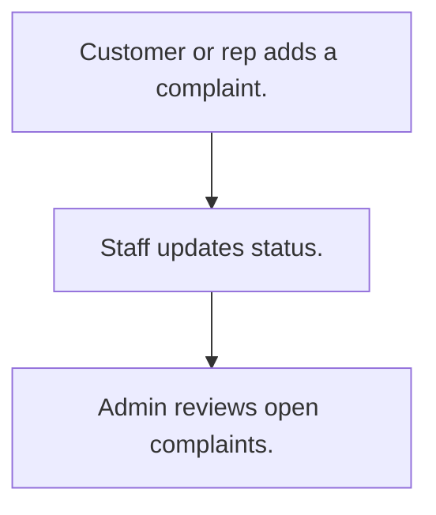

# Customer complaints

## Usual needs

- Usually has to let a customer or staff log a complaint for a customer with type, place, text and photos.
- Usually has to keep a complaint type list.
- Usually has to move the complaint through a status list.
- Usually has to list open complaints.

## Process steps

1. Customer or rep adds a complaint.
2. Staff updates status.
3. Admin reviews open complaints.

## Usual sheets, key fields, roles

- Complaint: Date, Customer ref, Type, Location, Description, photos, Status {Open|In Service|Resolved|Closed|Cancelled}
- ComplaintType: ComplaintType
- Roles: Customer, Employee or rep, Admin.

## Neome App / Delivery hint

Neome App: ticketing-and-task-management. Delivery: configuration. Hint only; grilling decides.

## Flowchart

