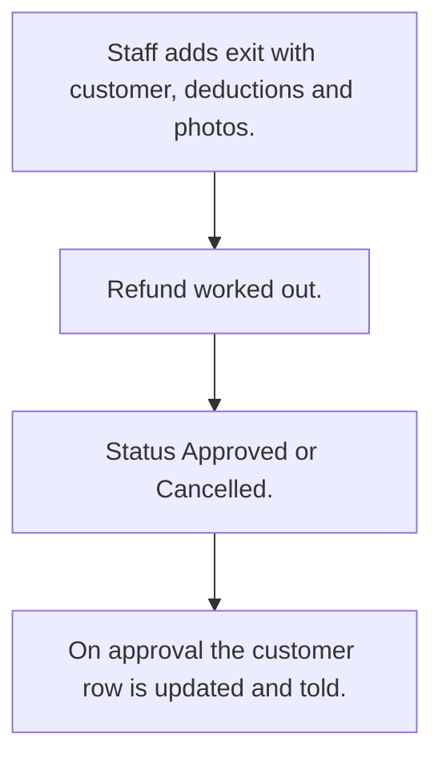

# Customer exit and settlement

## Usual needs

- Usually has to close a customer's account and settle the money.
- Usually has to work out the refund from deposit, balance and deductions.
- Usually has to keep photos and readings as proof of asset state.
- Usually has to approve or cancel the exit.
- Usually has to update the customer and tell them on approval.

## Process steps

1. Staff adds exit with customer, deductions and photos.
2. Refund worked out.
3. Status Approved or Cancelled.
4. On approval the customer row is updated and told.

## Usual sheets, key fields, roles

- Exit: Customer, UnpaidAmount, DamageAmount, OtherDeductions, RefundAmount, reading, photos, Reason, Status {Pending|Approved|Cancelled}
- Roles: Employee.

## Neome App / Delivery hint

Neome App: none in the catalog. Delivery: configuration. Hint only; grilling decides.

## Flowchart

