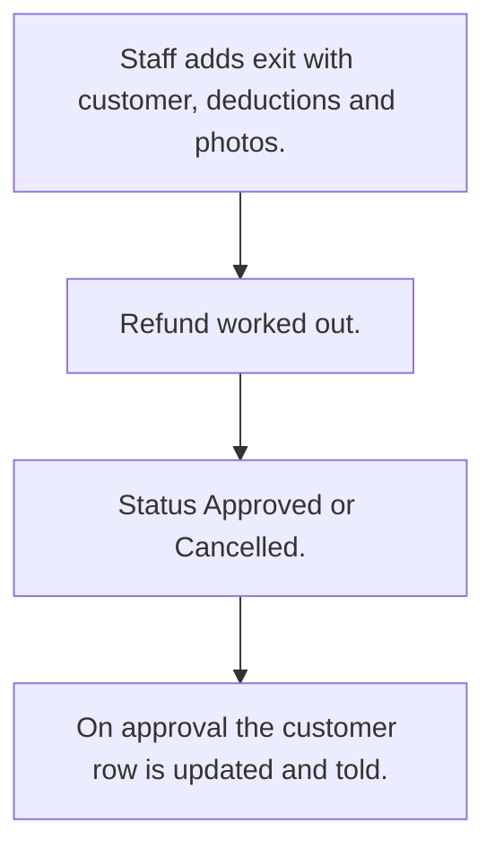

# Customer exit and settlement

## Usual needs

- Usually has to close a customer's account and settle the money.
- Usually has to work out the refund from deposit, balance and deductions.
- Usually has to keep photos and readings as proof of asset state.
- Usually has to approve or cancel the exit.
- Usually has to update the customer and tell them on approval.

## Process steps

1. Staff adds exit with customer, deductions and photos.
2. Refund worked out.
3. Status Approved or Cancelled.
4. On approval the customer row is updated and told.

## Usual sheets, key fields, roles

- Exit: Customer, UnpaidAmount, DamageAmount, OtherDeductions, RefundAmount, reading, photos, Reason, Status {Pending|Approved|Cancelled}
- Roles: Employee.

## Neome App / Delivery hint

Neome App: none in the catalog. Delivery: configuration. Hint only; grilling decides.

## Flowchart

## Execute

Only use this to apply this into a Studio Enterprise via MCP.

Placeholders: ExitSheet, CustomerSheet, VarExitStatus. Needs first: Customer sheet (TMOD-customer-master); it has no Deposit field and OutstandingAmount as balance, so add Deposit (from TMOD-customer-onboarding) or Open Item.

1. Roles + vars: `add kind=role` Employee; `add kind=var kind=setOfText` VarExitStatus (Pending, Approved, Cancelled).
2. Exit: `add kind=form` → `kind=composite type=section` → Customer `type=ref spreadsheet=CustomerSheet layoutSpreadsheet=<list>`, UnpaidAmount, DamageAmount, OtherDeductions, RefundAmount `type=decimal`, Reading `type=decimal`, Photos `type=image`, Reason `type=paragraph`, Status `type=pickText source=VarExitStatus` → `add kind=spreadsheet` → `kind=spreadsheetLayout kind=table`.
3. Logic: apply PAT-copy-fields-from-ref (deposit, balance), PAT-calculated-field (`formFormula assignToField=RefundAmount`), PAT-photo-and-document-capture Execute.
4. Approve: apply PAT-act-on-status-change Execute (`eventSsUpdateAfter spreadsheet=ExitSheet` → `branchIfElse` Approved → `rowUpdate` customer row); tell customer: PAT-message-on-event.
5. Actions + group: `kind=rowInsert` + `kind=spreadsheetEditor` Exit → `set kind=group actionPermissionMap` (Employee).
6. `validate` till ok=true. `describe` sheet + workflow.

Gaps: refund formula terms: confirm with user; customer `rowIdPointer` from ref field (verify: describe).
