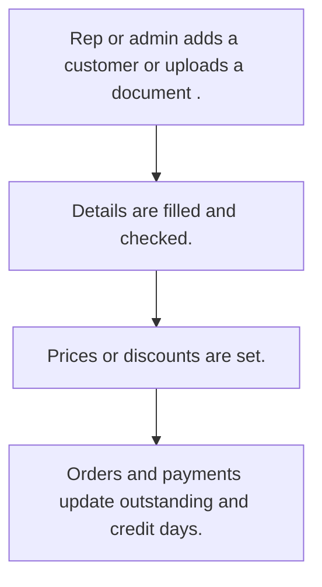

# Customer master

## Usual needs

- Usually has to keep customers with contact, tax ID, address, place and category.
- Usually has to keep several contacts and shipping addresses per customer.
- Usually has to keep a price or discount per customer for products or categories.
- Usually has to track credit limit, credit days and outstanding amount.
- Usually has to let reps see their own customers and managers see all.
- Usually has to sometimes read customer details from an uploaded document.

## Process steps

1. Rep or admin adds a customer (or uploads a document).
2. Details are filled and checked.
3. Prices or discounts are set.
4. Orders and payments update outstanding and credit days.

## Usual sheets, key fields, roles

- Customer: Name, ContactPerson, Mobile, Email, tax ID, Address, place refs, Category, discount or price grid, CreditAmount, CreditDays, OutstandingAmount (log), Status
- Roles: Sales rep, Manager, Admin, sales coordinator.

## Neome App / Delivery hint

Neome App: crm. Delivery: configuration. Hint only; grilling decides.

## Flowchart

